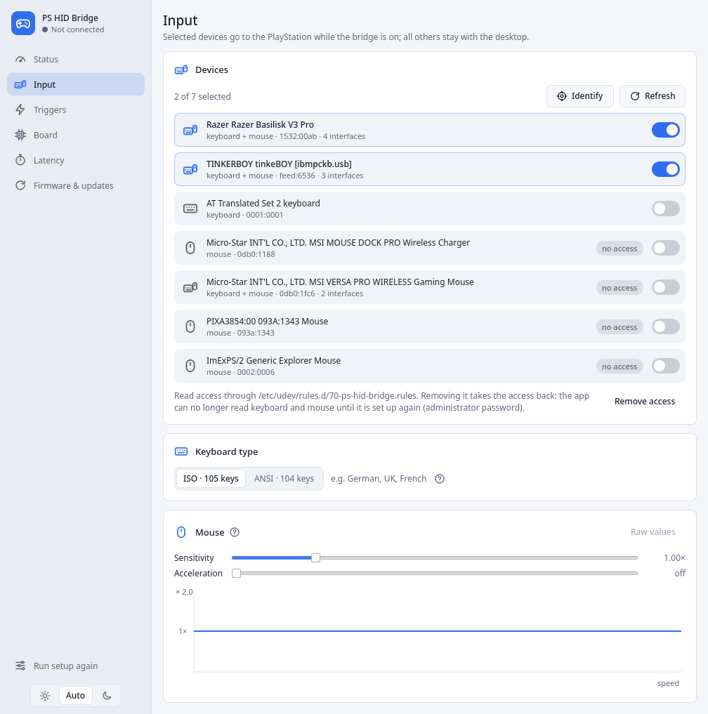

# PS HID Bridge

Control a PlayStation with the mouse and keyboard of a Linux PC while the picture comes in via Remote Play (chiaki-ng).

## Why

Remote Play only carries controller input: a game that supports mouse and keyboard on the PlayStation never gets them from the PC. PS HID Bridge adds that path through a small board on the PlayStation's USB port. The PlayStation sees an ordinary USB keyboard and mouse, and the controller keeps working through Remote Play.

| Path | Time |
|---|---|
| Picture: PlayStation encoder → network → chiaki-ng → display | tens of milliseconds |
| Mouse and keyboard: PC → network → board → the PlayStation's USB port | about 1–2 ms |

So the input adds next to nothing to what you see. The app's status page shows the time measured on your setup live (tile "Input → PlayStation", see [Latency](#latency)).

- **Safe, also in a shared network:** in a student hall, a shared flat or at a LAN party, any device in the network could otherwise send key presses to your PlayStation or read what you type on it (including passwords). The input travels encrypted with a key that only your PC and your board know: nobody else can control your PlayStation, read your input or replay it. What this covers and what not: [docs/security.md](docs/security.md).
- **Fails safe:** if no valid input arrives for 250 ms, the board lets go of every key, so a dropped network never leaves your character running. `Ctrl+Alt+Shift+Esc` always gives mouse and keyboard back to the PC and lets go of everything on the PlayStation. What happens when the network, the app or the board fails: [When something goes wrong](docs/security.md#when-something-goes-wrong).
- **Status:** version 1.0 works on real hardware (WIZnet W5500-EVB-Pico2 on a PlayStation 5, desktop app on Linux), and every part is tested automatically on each commit ([docs/development.md](docs/development.md)).

## How it works

Your input travels through three stations:

| Station | Hardware | What happens to your input | What you set up there |
|---|---|---|---|
| **1. The PC** (sender) | your Linux PC with mouse and keyboard | the app takes over the selected mouse and keyboard (the desktop no longer reacts to them while the bridge is on), encrypts every input with your key and sends it over your network | the app and its setup wizard |
| **2. The board** (bridge) | the W5500-EVB-Pico2: network cable to your router, USB cable to the PlayStation | it checks that the packet comes from your PC, decrypts it and turns it into what a USB keyboard and mouse send | the firmware once, then in its web interface your password and the key |
| **3. The PlayStation** (receiver) | its USB port | it fetches the keyboard and mouse state from the board once per millisecond, as from any USB keyboard and mouse | keyboard language, USB power in rest mode |

The controller keeps working through Remote Play.

## What you need

| | |
|---|---|
| **Board** | WIZnet W5500-EVB-Pico2 (RP2350 with the W5500 network chip) |
| **USB cable** | with data lines: board → PC for the first installation, then board → PlayStation |
| **Network cable** | from the board to your router or switch, in the same network as the PC (DHCP or a static address) |
| **PC** | Linux on x86_64 or ARM64 (aarch64, e.g. a Raspberry Pi 4/5 with a 64-bit system), glibc 2.34 or newer, with Wayland or X11, by cable or Wi-Fi (a cable is better); the administrator password once, so the app may read mouse and keyboard |
| **PlayStation** | a free USB port |

Optional:

- A Remote Play client such as chiaki-ng, for the picture on the PC. The bridge itself does not need it.
- rtkit for real-time priority (desktops with PipeWire usually have it).
- For the [window rule](#window-rule) (bridge on while a certain window has the focus): KDE Plasma, Hyprland, Sway, i3, niri or another desktop on X11; not GNOME on Wayland.
- Only to build it yourself: Docker, make and git (see [Building](docs/development.md#building)).

### Compatibility and limits

- **Mice:** wired, with a USB receiver or Bluetooth. Five buttons reach the PlayStation (left, right, middle, back, forward), and the wheel, also tilted sideways.
- **Polling rate: 1000 Hz is ideal.** The PlayStation fetches the mouse once per millisecond, so higher rates gain almost nothing there: only the mouse's own part (about 0.5 ms on average at 1000 Hz) gets shorter. 4000 or 8000 Hz work, but they send thousands of events per second: if the PC is busy for a moment, the kernel drops some of them. Buttons and keys are corrected at once (the status page shows "N× input corrected"; the app also checks them every 250 ms anyway), but the motion of that moment is lost, a small hitch. If the counter rises during play, set the mouse to 1000 Hz in its software, or make sure the app has real-time priority (see [Latency](#latency)).
- **USB receivers** (Logitech Lightspeed, Razer HyperSpeed and the like) appear as one entry with several interfaces; select the entry, it takes all of them. Some receivers lose a button release now and then: see [A mouse button stays pressed](docs/troubleshooting.md#a-mouse-button-stays-pressed).
- **Bluetooth** mice and keyboards work, but Bluetooth adds several milliseconds of its own.
- **Keyboards:** up to six keys at once reach the PlayStation, plus Ctrl, Shift, Alt and Super; with more, it reacts like any USB keyboard that ran out of keys. Keyboards with full rollover work the same way.
- **Touchpads and touchscreens** work as a mouse, see [below](#touchpads-and-touchscreens).
- **Not forwarded:** game controllers (they keep working through Remote Play) and graphics tablets.
- **PC:** 64-bit Linux on x86_64 or ARM64 (aarch64); no 32-bit systems. The window rule works on KDE Plasma, Hyprland, Sway, i3, niri and X11 desktops, not on GNOME with Wayland.
- **Board:** only the WIZnet W5500-EVB-Pico2, connected by network cable (it has no Wi-Fi). Tested with a PlayStation 5.

## Quick start

Station by station, as in [How it works](#how-it-works).

**Station 2, the board** (first, the other two need it):

1. **Get the files:** download them from the [latest release](https://github.com/upchui/PS-HID-Bridge/releases/latest), or build them yourself with `make submodules && make all` (see [Building](docs/development.md#building); the first run takes long because of Qt).
2. **Flash the board:** hold BOOTSEL and plug the board into the PC via USB; the drive `RP2350` appears. First copy `ps-hid-bridge-pt.uf2` onto it (the board comes back as a drive afterwards), then `ps-hid-bridge.uf2`. Or let the app do it (setup wizard or "Firmware & updates" → "Install via USB").
   The first file is the partition table: it divides the board's memory into two places for the firmware and one for your settings. An update over the network then goes into the free place, and if the new firmware does not start properly, the board returns to the previous one. Without it, every update overwrites the running firmware.
3. **Connect the board:** network cable, USB to the PlayStation. Find its address with `pshb-cli discover` or in the app (setup wizard or "Board" → "Search"), or look it up in your router (`ps-hid-bridge-XXXXXX`), and open it in the browser; `http://ps-hid-bridge-XXXXXX.local` works too where the network passes mDNS.
4. **Web interface:** log in with `ps-hid-bridge`, set your own password, generate a key under "Security". Or skip this: the app's wizard gets the key itself with the web password ("Get the key", see [Board](#using-the-app)).

**Station 1, the PC:**

5. **App:** start the AppImage for your processor, `PS-HID-Bridge-x86_64.AppImage` (Intel, AMD) or `PS-HID-Bridge-aarch64.AppImage` (ARM64). The wizard asks for the board address and key (pasted, or taken from the board with its web password), the devices, the keyboard type and the trigger.

**Station 3, the PlayStation:**

6. **Settings:** set the keyboard language to the layout of your keyboard (see [Keyboard layout](#keyboard-layout)) and switch on USB power in rest mode in the power saving settings.

Every commit on `main` becomes a release on the [releases page](https://github.com/upchui/PS-HID-Bridge/releases) with the AppImage, the command line tool and the firmware.

## Using the app

The AppImage runs on current Linux systems under Wayland and X11. It follows the desktop's light or dark mode; the switch at the bottom of the sidebar picks light, automatic or dark, the one next to it the language (English or Deutsch). Changes are saved as soon as they are valid; only the board's address and key wait for "Save and connect" (in the wizard: "Next").

- **Wizard** on first start: welcome (with the firmware install over USB for a new board) → board (the boards found in the network to pick from, address, key, connection test) → devices and keyboard type → trigger → live test that shows what reaches the PlayStation. "Run setup again" in the sidebar starts it again.
- **Status:** bridge on/off, the keys that currently go to the PlayStation, the board and the PlayStation (connected or in rest mode), the network latency to the board and how long the PC takes with your input. The tile "Input → PlayStation" adds up the whole way from your input to the PlayStation fetching it. Plus "Release all keys", "Pause" and "Reconnect", and [typing text](#typing-text) on the PlayStation. A warning appears when the board refuses packets from somewhere else: another PC with an old key, or a second PC with the same key.
- **Input:** keyboards, mice, touchpads and touchscreens, grouped per device, selected ones first; "Identify" marks the device you are typing on. The keyboard type (ISO or ANSI), the [profiles](#profiles-and-remapped-keys) with their mouse settings (sensitivity and acceleration with a curve preview, vertical speed, inverted vertical axis, wheel speed; the default is the raw values) and remapped keys, and the touchpad settings.
- **Triggers:** how you switch between desktop and PlayStation: a key combination, a mouse button (`Mouse4`, `Mouse5`), *Hold* (bridge on only while pressed) or *Double tap* (while the bridge is on, both taps also reach the PlayStation); each with the action Toggle, Switch on, Switch off, Pause, Release all (lets go of everything on the PlayStation, also a button the mouse still reports held), a certain profile or the next profile. "Record" takes over the combination you press. Also the window rule (see below).
- **Board:** the boards in the network ("Search"; a tap takes one's address), address and key, connection state, "Open web interface", and the board's name (shown in the search; your router and the browser get a network name made from it, e.g. `wohnzimmer-ps5`). If the board gets another address from the router, the app finds it again by its MAC address and switches over by itself, also while the bridge is on. "Get the key" takes the key from the board with its web password, instead of copying it from the web interface (on a new board the app asks for your own password first); the board makes a new key then, so another PC with the old one needs it too.
- **Latency:** what the board measures on its way from the network to the PlayStation (see [docs/latency.md](docs/latency.md)), and its clock speed; "Start over" resets the statistics.
- **Firmware & updates:** installed and newest version of app and board firmware, "Install via USB", and "Save diagnostics": one text file with versions, system, settings (without the key), devices, what the board says about itself and the app's recent messages, to attach to a bug report.
- **Tray icon:** grey = board not reachable, blue = ready, green = bridge on. A click toggles; its menu has "Bridge on/off", "Show window", "Release all keys" and "Quit". A notification appears when the bridge switches.
- **Screen stays on:** while the bridge is on, the app keeps the screen from dimming and locking, although the desktop sees no input meanwhile.
- **Emergency stop:** `Ctrl+Alt+Shift+Esc` always releases mouse and keyboard at once and lets go of everything on the PlayStation. This combination cannot be switched off.
- **Every keyboard counts:** triggers and the emergency stop work on every keyboard, also on ones that are not selected (e.g. the laptop keyboard next to a gaming keyboard). Those are only watched: nothing of them goes to the PlayStation.

The bridge only switches on once all keys are released: if the devices were taken over while a key is down, that key would stay stuck on the desktop. *Hold* triggers are the exception, because their key is down by definition: the desktop never sees that key (or any other key held at that moment) go up and keeps it pressed afterwards; only reconnecting the device or logging out helps. Use a hold key on a device that is not selected (a second keyboard, see "Every keyboard counts"), or one the desktop does not need. The emergency stop and "Switch off" end a hold until its key is released. If the app hangs, mouse and keyboard return to the desktop after one second.

### Keyboard layout

The board sends key **positions**, not characters, just like a real USB keyboard. The PlayStation turns them into characters with its own keyboard language setting. So:

- **On the PlayStation**, set the keyboard language in the keyboard settings to the layout printed on your keyboard, e.g. German for a German keyboard.
- **In the app**, choose the physical keyboard type under "Input" (or in the wizard):

| Type | Typical layouts | Recognisable by |
|---|---|---|
| ISO (default) | German, UK, French, Nordic … (105 keys) | L-shaped Enter key, extra key next to the left Shift |
| ANSI | US (104 keys) | wide single-row Enter key, backslash key above Enter |

The type only matters for the key next to Enter (`#'` on a German keyboard, `\|` on a US keyboard). Every other key is the same for both types.

### Profiles and remapped keys

A profile holds the mouse settings and a list of remapped keys, e.g. one per game. "Standard" always exists; "Input" → "Profiles" adds more (a copy of the one shown), renames and removes them.

- **Remapped keys:** a key or mouse button reaches the PlayStation as another one, or not at all, e.g. the mouse's side button as `F` when a game does not let you bind it, or `CAPSLOCK` as `Ctrl`. Type the key names (as on a US keyboard: `F`, `SPACE`, `LEFTSHIFT`; `Ctrl` stands for both Ctrl keys) or record them; "…" offers the mouse buttons and "Nothing". Triggers and the emergency stop always see the real keys.
- **Mouse:** besides sensitivity and acceleration, the vertical speed (relative to the horizontal one), an inverted vertical axis and the wheel speed (0.5 = one step per two notches). These three apply to touchpads too.
- **Choosing a profile:** "Use" on the Input page, the tray menu ("Profile"), or a trigger with the action "Profile …" or "Next profile". A key held while the profile changes keeps its old meaning until you let go of it, so nothing stays pressed on the PlayStation.
- **A profile for a window:** with a window pattern (like the [window rule](#window-rule)'s), the profile applies by itself while that window has the focus, and the one chosen by hand again when the focus moves on. Choosing another profile by hand wins until the focus moves to another window.
- Adding, renaming or removing a profile switches the bridge off (the app restarts its connection); changing a profile's settings does not.

### Typing text

"Type text on the PlayStation" on the Status page types a text as key presses, e.g. a long password from your password manager or a message: paste it, put the cursor into the PlayStation's text field, switch the bridge off, then "Type".

- **Keyboard language:** as with a real keyboard, the PlayStation turns key positions into characters with its own keyboard language, so choose the same one in the card (English (US), English (UK) or Deutsch; the default follows your system's language). Characters that language has no key for are named before anything is typed. Accented letters such as `é` are typed with the dead key, as you would.
- The text is hidden while you type it in (the eye shows it), not stored and not logged. Switching the bridge on stops typing.
- From the command line: `pshb-cli type "text"` (see [docs/advanced-setup.md](docs/advanced-setup.md)).

### Touchpads and touchscreens

The PlayStation knows a mouse only, so the app turns your fingers into mouse input:

- **One finger** moves the mouse: slow movements are precise, fast ones cover distance. The speed is set on the Input page; the mouse sensitivity applies too.
- **Two fingers** scroll. "Natural scrolling" reverses the direction.
- **Clicking a clickpad** (the whole surface is the button): left; with two fingers on it, or pressing in the bottom-right corner, right; with three fingers middle. A thumb resting on the bottom of the pad moves nothing, so it can click while another finger moves. Touchpads with separate buttons pass them on.
- **Tapping** (on by default): one finger left, two right, three middle. A tap right after a key press does not click, so a palm resting on the touchpad while you play with WASD stays harmless.
- **Touchscreens** work like a large touchpad: dragging moves the mouse, a tap clicks.

Many laptop touchpads appear twice ("… Mouse" and "… Touchpad") as one entry in the list; select the entry.

### Window rule

The window rule switches the bridge on by itself while a certain window has the focus, and off again when the focus moves elsewhere. It works on KDE Plasma (with a small KWin script), Hyprland, Sway and i3, niri, and on every desktop with X11; the Triggers page shows which one the app found. GNOME on Wayland tells applications nothing about the focused window, so the rule is not available there.

- **Off by default.** Switch it on under "Triggers" → "Window rule".
- The pattern is matched against the window title, the program and the desktop file name, ignoring case. The default `chiaki-ng` matches the Remote Play window of chiaki-ng.
- "Pause" suspends the rule until the next window change; "Switch off" overrides it while the window keeps the focus.
- `pshb-cli run` follows the window rule too.
- [Profiles](#profiles-and-remapped-keys) can follow a window the same way.

### Device access

A normal user may not read mouse and keyboard directly. "Set up access" (in the wizard, and on the Input and Triggers pages) allows it once for the selected devices and every keyboard; it asks for the administrator password. "Remove access" on the Input page takes it back (the bridge must be off). To do it by hand, see [Device access by hand](docs/advanced-setup.md#device-access-by-hand).

## Updates

When a new release is out, the Status page shows a banner with "Update app" (the AppImage replaces itself, then "Restart now") and "Update board" (the board's firmware over the network; the bridge must be off). If the new firmware does not start properly, the board returns to the previous version by itself. The app looks for updates at start and every six hours; the switch on "Firmware & updates" turns that off.

The board can also be updated in its web interface (System → firmware file). How updates are checked and signed, and how to recover a board: [docs/advanced-setup.md](docs/advanced-setup.md#board).

## Latency

The input path takes about 1–2 ms from a key press or mouse movement to the PlayStation; the video path (PlayStation encoder → network → chiaki-ng → display) takes tens of milliseconds. Where the time goes, from the input reaching the PC to the PlayStation fetching the report:

| Part | Typical | Shown in the app |
|---|---|---|
| This PC: input event → packet sent | about 0.1 ms | Status: "Input → network" |
| Network: PC → board, on a cable | 0.1–0.2 ms | Status: "Network latency to the board" |
| Board: packet → report ready | 52–56 µs | Latency page |
| Waiting for the PlayStation's poll (once per millisecond) | about 0.5 ms on average | Latency page |

The tile "Input → PlayStation" on the status page adds up the medians measured on your setup. Not included: the time until the PC fetches the input from the mouse or keyboard (their own USB polling).

### The PlayStation's poll

The PlayStation fetches the board's report once per millisecond. An input that is ready waits for the next fetch: half a millisecond on average, anything from nothing to a full millisecond depending on when it arrives. Every microsecond saved before that moves the average by one microsecond, because some inputs now catch an earlier fetch; nothing doubles when an input just misses one, it simply takes the next. What you feel more than single microseconds is a delay that comes and goes: then the same movement sometimes makes a fetch and sometimes not, and aiming feels uneven. So steady matters more than fast.

### What helps how much

Largest effect first. The app does most of it by itself; details, how to do it by hand and how to measure: [docs/latency-pc.md](docs/latency-pc.md).

| What | Effect | Where |
|---|---|---|
| **PC on a cable** instead of Wi-Fi | PC → board 0.1–0.2 ms, and steady; Wi-Fi varies with everything else on the air (the app marks its packets as urgent, which helps but does not make it a cable) | connect the PC and the PlayStation by cable, the board to the same switch |
| **USB network adapter** (many USB-C docks and USB Ethernet adapters) | they hold every packet back to bundle it, up to 3 × 400 µs; the app switches that off while it runs | "Set up" when the status page warns about it (administrator password, once) |
| **Real-time priority** | input → network stays at about 0.1 ms (99 % below 0.3 ms) also when every core is busy | automatic through rtkit; the status page says "normal priority" if it is missing, see [troubleshooting](docs/troubleshooting.md#the-status-page-says-normal-priority) |
| **Processor kept awake** while the bridge is on | the slowest wake-up of a core drops from about 290 to 45 µs | on by default; Latency page, "This PC" ("Set up" once where the system does not allow it) |
| **Mouse at 1000 Hz** | the mouse's own part is 0.5 ms on average; higher rates gain little here and can lose motion, see [Compatibility and limits](#compatibility-and-limits) | the mouse's own software |
| **Board at 200 MHz with fast SPI** | the board's part drops from 52–56 to 40 µs (median) and from about 106 to 78 µs for 99 % of the packets; beyond the processor's rating, if a board does not run stably it goes back to 150 MHz by itself | Latency page, "Clock speed" (the board restarts; not while the bridge is on) |

**For competitive play:** PC on a cable; no warning about the network adapter on the status page (or "Set up" done); "real-time priority" and "CPU kept awake" on the status page; the mouse at 1000 Hz; then, if you like, the board's clock. "Undo" on the Latency page ("This PC", administrator password) removes the system settings the app made.

The board's side, stage by stage with measurements and clock speeds: [docs/latency.md](docs/latency.md).

## Troubleshooting

- [A mouse button stays pressed](docs/troubleshooting.md#a-mouse-button-stays-pressed)
- [The board is not found over USB](docs/troubleshooting.md#the-board-is-not-found-over-usb)
- [Wrong characters on the PlayStation](docs/troubleshooting.md#wrong-characters-on-the-playstation)
- [The app cannot read mouse or keyboard](docs/troubleshooting.md#the-app-cannot-read-mouse-or-keyboard)
- [The status page says "normal priority"](docs/troubleshooting.md#the-status-page-says-normal-priority)
- [The status page warns about the network adapter](docs/troubleshooting.md#the-status-page-warns-about-the-network-adapter)
- [The board went back to the previous firmware after an update](docs/troubleshooting.md#the-board-went-back-to-the-previous-firmware-after-an-update)
- [The search finds no board](docs/troubleshooting.md#the-search-finds-no-board)
- [The status page warns about refused packets](docs/troubleshooting.md#the-status-page-warns-about-refused-packets)
- [Reporting a problem](docs/troubleshooting.md#reporting-a-problem): "Save diagnostics" on "Firmware & updates"
- **Forgot the web password:** hold the board's BOOTSEL button for 5 seconds while it runs, then let go. It restarts with factory settings (password, key and network settings are erased); set it up again from step 4 of the [Quick start](#quick-start).

## More documentation

| Document | Content |
|---|---|
| [docs/troubleshooting.md](docs/troubleshooting.md) | problems and where to look |
| [docs/security.md](docs/security.md) | what the key and the encryption protect against, what not, and how |
| [docs/advanced-setup.md](docs/advanced-setup.md) | the command line tool, the board's web interface in detail, updates, flashing and recovery, image files, settings files, device access by hand |
| [docs/latency-pc.md](docs/latency-pc.md) | what the app does for a short input path on the PC and the network, how to undo it, how to measure |
| [docs/latency.md](docs/latency.md) | the board's input path, stage by stage, with measurements |
| [docs/usb-host-port.md](docs/usb-host-port.md) | how to solder a USB host port to two GPIOs (not used by the firmware), and what was tried with it |
| [docs/protocol.md](docs/protocol.md) | how the app and the board talk over UDP, step by step, and what happens when something goes wrong |
| [docs/development.md](docs/development.md) | test status, building, continuous integration, testing without a board, screenshots, checks on real hardware, directories |
| [protocol/SPEC.md](protocol/SPEC.md) | the packet format, byte by byte |
