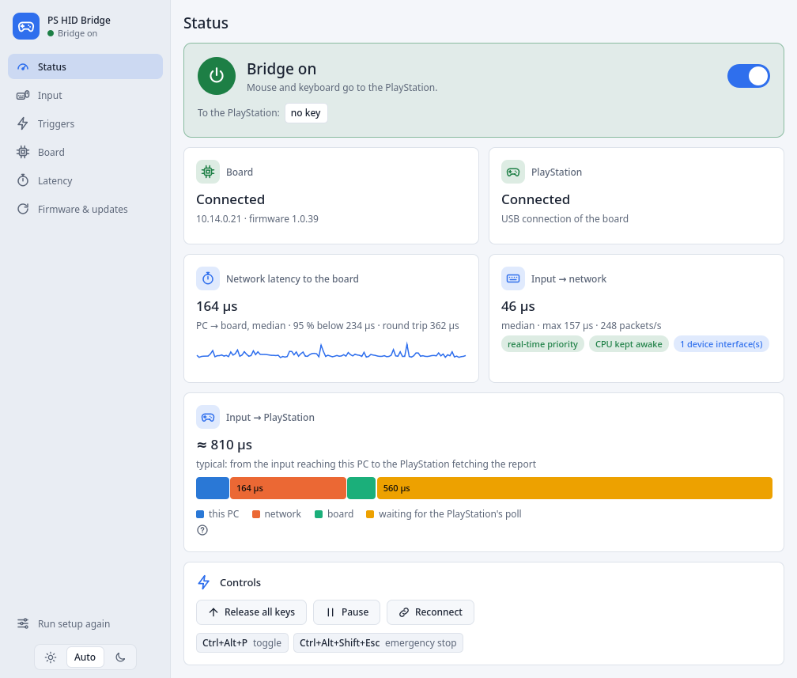
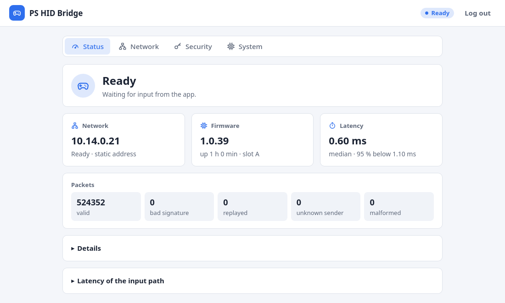
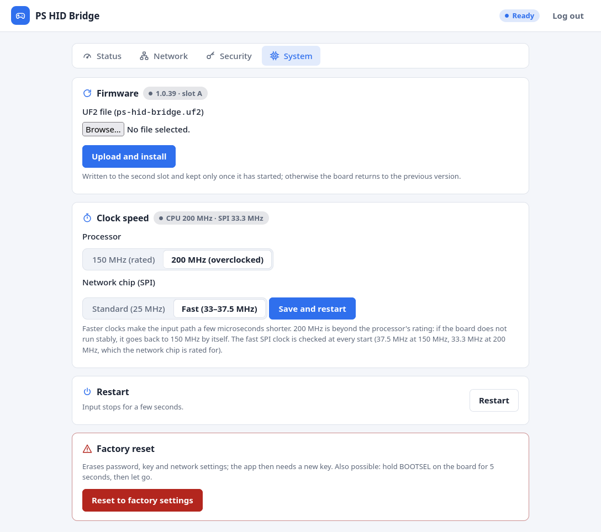
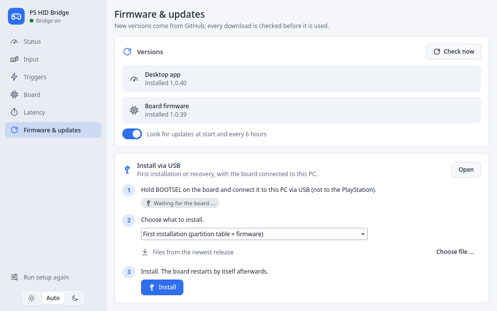

# PS HID Bridge

Control a PlayStation with the mouse and keyboard of a Linux PC while the picture comes in via Remote Play (chiaki-ng).



## Why

Remote Play only carries controller input: a game that supports mouse and keyboard on the PlayStation never gets them from the PC. PS HID Bridge adds that path through a small board on the PlayStation's USB port. The PlayStation sees an ordinary USB keyboard and mouse, and the controller keeps working through Remote Play.

| Path | Time |
|---|---|
| Picture: PlayStation encoder → network → chiaki-ng → display | tens of milliseconds |
| Mouse and keyboard: PC → network → board → the PlayStation's USB port | about 1–2 ms |

So the input adds next to nothing to what you see. The app's status page shows the time measured on your setup live (tile "Input → PlayStation", see [Latency](#latency)).

- **Safe:** the input travels encrypted. If no valid packet arrives for 250 ms, the board releases all keys. `Ctrl+Alt+Shift+Esc` always gives mouse and keyboard back to the PC and lets go of everything on the PlayStation.
- **Status:** version 1.0 works on real hardware (WIZnet W5500-EVB-Pico2 on a PlayStation, desktop app on Linux), and every part is tested automatically on each commit ([docs/development.md](docs/development.md)).

## How it works

1. The desktop app reads mouse and keyboard via evdev and grabs them exclusively.
2. It encrypts the input (ChaCha20-Poly1305) and sends it over the LAN via UDP.
3. The board (WIZnet W5500-EVB-Pico2) verifies and decrypts it and passes it on to the PlayStation as USB HID reports.
4. The PlayStation sees an ordinary keyboard and mouse. The controller keeps working through Remote Play.

The packet format is described in [protocol/SPEC.md](protocol/SPEC.md). If no valid packet arrives for 250 ms, the board releases all keys (failsafe).

## What you need

| | |
|---|---|
| **Board** | WIZnet W5500-EVB-Pico2 (RP2350 with the W5500 network chip) |
| **USB cable** | with data lines: board → PC for the first installation, then board → PlayStation |
| **Network cable** | from the board to your router or switch, in the same network as the PC (DHCP or a static address) |
| **PC** | Linux on x86_64 (glibc 2.34 or newer) with Wayland or X11, by cable or Wi-Fi (a cable is better); the administrator password once, so the app may read mouse and keyboard |
| **PlayStation** | a free USB port |

Optional:

- A Remote Play client such as chiaki-ng, for the picture on the PC. The bridge itself does not need it.
- rtkit for real-time priority (desktops with PipeWire usually have it).
- KDE Plasma for the [window rule](#window-rule) (bridge on while a certain window has the focus).
- Only to build it yourself: Docker, make and git (see [Building](docs/development.md#building)).

## Quick start

1. **Get the files:** download them from the [latest release](https://github.com/upchui/PS-HID-Bridge/releases/latest), or build them yourself with `make submodules && make all` (see [Building](docs/development.md#building); the first run takes long because of Qt).
2. **Flash the board:** hold BOOTSEL and plug the board into the PC via USB; the drive `RP2350` appears. First copy `out/ps-hid-bridge-pt.uf2` onto it (partition table; the board comes back as a drive afterwards), then `out/ps-hid-bridge.uf2`. Or let the app do it (setup wizard or "Firmware & updates" → "Install via USB") or `pshb-cli flash` (see [Flashing over USB from the PC](#flashing-over-usb-from-the-pc)).
3. **Connect the board:** network cable, USB to the PlayStation. Look up the IP in your router (`ps-hid-bridge-XXXXXX`) and open it in the browser.
4. **Web interface:** log in with `ps-hid-bridge`, set your own password, generate a key under "Security".
5. **App:** start `out/PS-HID-Bridge-x86_64.AppImage`. The wizard asks for the board address and key, the devices, the keyboard type and the trigger.
6. **PlayStation:** set the keyboard language to the layout of your keyboard (see [Keyboard layout](#keyboard-layout)) and switch on USB power in rest mode in the power saving settings.

## Download

Every commit on `main` is built and tested automatically and published as a release on the [releases page](https://github.com/upchui/PS-HID-Bridge/releases), named after its version, e.g. `v1.0.3`; the newest one is marked "Latest". Each release contains the AppImage, the command line tool (`pshb-cli-x86_64-linux`), all firmware images and `SHA256SUMS`. The last part of the version is the number of commits since the version (`1.0`) was raised, so every commit has a higher version than the one before; the app, `pshb-cli --version` and the firmware (web interface, "Status" page of the app) all show the same version.

## Desktop app

`out/PS-HID-Bridge-x86_64.AppImage` runs on current Linux systems (built against glibc 2.34) under Wayland and X11. It follows the desktop's light or dark mode; the switch at the bottom of the sidebar picks light, automatic or dark. Changes are saved as soon as they are valid, there is no "Save" button.

- **Wizard** on first start: board (address, key, connection test; or first install the firmware over USB) → devices and keyboard type → trigger → live test that shows what reaches the PlayStation. "Run setup again" in the sidebar starts it again.
- **Status:** bridge on/off, the keys that currently go to the PlayStation, tiles for the board, the PlayStation (connected/rest mode), the network latency to the board (PC → board: median, 95th percentile, history; the round trip underneath) and the path from input to network, all in microseconds; a tile "Input → PlayStation" adds up the whole way from the input reaching the PC to the PlayStation fetching the report (this PC, network, board, waiting for the PlayStation's poll; medians, the board's part fetched from the board every 5 s while the page is shown), plus "Release all keys", "Pause" and "Reconnect". If the app fell behind for a moment and the kernel dropped input events (fast mice send several thousand per second), the app compares with the real key state right away, so no button stays held on the PlayStation; the page then shows "N× input corrected". As a safety net it also does that every 250 ms.
- **Input:** keyboards, mice, touchpads and touchscreens, grouped per device, selected ones first; "Identify" marks the device you are typing on, "Set up access" appears for devices the user may not read. The keyboard type (ISO or ANSI), mouse sensitivity and acceleration with a curve preview (the default is the raw values), and the touchpad's speed, tap to click and natural scrolling (see [Touchpads and touchscreens](#touchpads-and-touchscreens)).
- **Triggers:** key combination, mouse button (`Mouse4`, `Mouse5`), *Hold* (bridge on only while pressed) and *Double tap* (while the bridge is on, both taps also reach the PlayStation); each with the action Toggle, Switch on, Switch off, Pause or Release all (lets go of everything on the PlayStation, also a button the mouse still reports held, see [A mouse button stays pressed](docs/troubleshooting.md#a-mouse-button-stays-pressed)). "Record" takes over the combination you press. Also the window rule (see below).
- **Board:** address and key, connection state, "Open web interface".
- **Latency:** what the board measures on its input path (see [docs/latency.md](docs/latency.md)): packet → report ready (median, 99 %, slowest), the PlayStation's fetch, the wait for the SPI bus, missed polls and the decryption time; where the time of a typical packet goes, the spread of every stage, how long before each poll the mouse report is filled, the board's details, and its clock speed (the board restarts to apply it; not while the bridge is on). The app asks with the key (signed requests), not with the web password, and only while its window is shown; "Start over" resets the statistics.
- **Firmware & updates:** installed and newest version of app and board firmware, "Check now", the automatic check (at start and every six hours), and "Install via USB" (see [Flashing over USB from the PC](#flashing-over-usb-from-the-pc)).
- **Tray icon:** grey = board not reachable, blue = ready, green = bridge on. A click toggles; its menu has "Bridge on/off", "Show window", "Release all keys" and "Quit". A Plasma notification appears when the bridge switches.
- **Screen stays on:** while the bridge is on, the desktop sees no input from the grabbed mouse and keyboard and would dim the screen, turn it off and lock it. The app asks it not to (D-Bus: `org.freedesktop.ScreenSaver`, else the desktop portal's idle inhibition, e.g. on GNOME) until the bridge switches off, pauses or the app quits; Plasma lists PS HID Bridge in the power applet meanwhile. `pshb-cli run` does the same.
- **Updates:** when a new release is out, the Status page shows a banner with "Update app" (the AppImage replaces itself, then "Restart now") and "Update board" (firmware over the network, signed with the key; the bridge must be off). See "Updates from the app and the command line".
- **Emergency stop:** `Ctrl+Alt+Shift+Esc` always releases mouse and keyboard at once and lets go of everything on the PlayStation. This combination cannot be switched off.
- **Every keyboard counts:** triggers and the emergency stop work on every keyboard, also on ones that are not selected (e.g. the laptop keyboard next to a gaming keyboard). Those are only watched: never grabbed, nothing of them goes to the PlayStation. The Triggers page offers "Set up access" if a keyboard cannot be read yet.


The bridge only switches on once all keys are released: if the devices were grabbed while a key is down, that key would stay stuck on the desktop. *Hold* triggers are the exception, because their key is down by definition: the desktop saw it go down before the devices were grabbed, but never sees it (or any other key held at that moment) go up, because that happens while they are grabbed. It keeps that key pressed afterwards, and pressing it again does not help (the hold starts again and swallows the release); only reconnecting the device or logging out does. Use a hold key on a device that is not selected (a second keyboard, see "Every keyboard counts"), or one the desktop does not need. The emergency stop and "Switch off" end a hold until its key is released. If the app hangs, a watchdog releases the devices after one second.

Settings: `~/.config/ps-hid-bridge/config.toml`, key: `~/.config/ps-hid-bridge/psk` (readable by the user only). The project used to be called PS5 HID Bridge: settings, key and packet counter under the old name (`~/.config/ps5-hid-bridge`, `~/.local/state/ps5-hid-bridge`) move to the new folders on the first start, and "Set up access" replaces the old udev rule file.

### Keyboard layout

The board sends key **positions**, not characters, just like a real USB keyboard. The PlayStation turns them into characters with its own keyboard language setting. So:

- **On the PlayStation**, set the keyboard language in the keyboard settings to the layout printed on your keyboard, e.g. German for a German keyboard.
- **In the app**, choose the physical keyboard type under "Input" (or in the wizard):

| Type | Typical layouts | Recognisable by |
|---|---|---|
| ISO (default) | German, UK, French, Nordic … (105 keys) | L-shaped Enter key, extra key next to the left Shift |
| ANSI | US (104 keys) | wide single-row Enter key, backslash key above Enter |

The type only matters for the key next to Enter (`#'` on a German keyboard, `\|` on a US keyboard): ISO sends HID code 0x32, ANSI 0x31. Every other key is the same for both types.

With the command line tool: `pshb-cli config set --keyboard iso` or `--keyboard ansi`.

### Touchpads and touchscreens

The PlayStation knows a relative mouse only, so the app turns finger contacts into mouse input:

- **One finger** moves the mouse. The motion is accelerated: slow movements are precise, fast ones cover distance. The speed is set on the Input page; the mouse sensitivity applies too.
- **Two fingers** scroll (wheel steps), along the axis they mostly move on. "Natural scrolling" reverses the direction.
- **Clicking a clickpad** (the whole surface is the button): left; with two fingers on it, or pressing in the bottom-right corner, right; with three fingers middle. A thumb resting on the bottom of a clickpad moves nothing, so it can click while another finger moves. Touchpads with separate buttons pass them on.
- **Tapping** (on by default): one finger left, two right, three middle. A tap right after a key press does not click: a palm resting on the touchpad while you type with WASD stays harmless, moving the mouse still works.
- **Touchscreens** work like a large touchpad: dragging moves the mouse, a tap clicks. While the bridge is on, a selected touchscreen belongs to the PlayStation like any selected device.

Many laptop touchpads have a second node named "… Mouse" next to the "… Touchpad": both are in the same group in the list, selecting the group takes both.

With the command line tool: `pshb-cli config set --touchpad-speed 1.5 --tap-to-click on --natural-scroll off`.

### Window rule

The window rule switches the bridge on by itself while a certain window has the focus, and off again when the focus moves elsewhere. It needs KDE Plasma (a small KWin script reports the active window).

- **Off by default.** Switch it on under "Triggers" → "Window rule".
- The pattern is matched against the window title, the program (window class) and the desktop file name, ignoring case. The default `chiaki-ng` matches the Remote Play window of chiaki-ng.
- "Pause" suspends the rule until the next window change; "Switch off" overrides it while the window keeps the focus.

With the command line tool (the setting is used by the desktop app): `pshb-cli config set --window-rule-enabled on --window-rule chiaki-ng`.

### Device access

A normal user may not read keyboard and mouse raw. In the wizard the app sets up a udev rule for **the selected devices and every keyboard** (it asks once for the administrator password); the keyboards are needed so that triggers and the emergency stop work on all of them:

```
# /etc/udev/rules.d/70-ps-hid-bridge.rules
SUBSYSTEM=="input", KERNEL=="event*", ENV{ID_INPUT_KEYBOARD}=="1", TAG+="uaccess"
SUBSYSTEM=="input", KERNEL=="event*", ATTRS{id/vendor}=="046d", ATTRS{id/product}=="c52b", TAG+="uaccess"
```

This lets the logged-in user's programs read every keyboard (as with the selected devices). To revoke it: "Remove access" on the Input page (administrator password; the bridge must be off). It deletes the file and takes the read access back right away; the app can then no longer read keyboard and mouse. By hand: `sudo rm /etc/udev/rules.d/70-ps-hid-bridge.rules`, then the access ends when the devices are plugged in again or the computer restarts.

By hand: `pshb-cli list-devices` shows vendor and product ID in the "ID" column; afterwards run `sudo udevadm control --reload && sudo udevadm trigger -s input`. The file name must start with a number below 73, otherwise `uaccess` has no effect. Alternative: `sudo usermod -aG input $USER` and log in again (access to all input devices).

## Command line tool

`out/pshb-cli` does the same without a user interface (and without the window rule); `pshb-cli run` also keeps the screen on while the bridge is on.

```sh
pshb-cli list-devices                              # keyboards, mice, touchpads, touchscreens with access status
pshb-cli config set --board 192.168.1.50 --device 046d:c52b --device "G Pro"
pshb-cli config set --keyboard ansi                # physical keyboard type (iso or ansi)
pshb-cli config set-psk <64 hex digits>            # store the key
pshb-cli config show                               # current settings
pshb-cli ping                                      # connection and board status
pshb-cli run                                       # forward; toggle with Ctrl+Alt+P
pshb-cli run --stats                               # also print the input latency every 5 s
pshb-cli update --check                            # installed and newest versions (also of the board)
pshb-cli update                                    # replace pshb-cli with the newest release
pshb-cli update --firmware                         # install the newest firmware on the board
pshb-cli update --firmware --file ps-hid-bridge.uf2  # ... or a file
pshb-cli board                                     # latency of the board's input path, status, clock
pshb-cli board --cpu 200 --spi fast                # set the clock speeds (the board restarts)
pshb-cli flash                                     # first installation over USB (BOOTSEL), see below
pshb-cli flash --image erase                       # recovery images: firmware, hidtest, hidtest-mouse8, erase
```

Key names in combinations follow the **position on a US keyboard** (`Z` is the `Y` key on a German keyboard). Modifiers: `Ctrl`, `Alt`, `AltGr`, `Shift`, `Super`; mouse buttons: `Mouse4`, `Mouse5`, `MouseMiddle`. The German names of earlier versions (`Strg`, `Umschalt`, `Maus4` …) are still accepted.

`pshb-cli replay FILE` plays input from a text file through the same logic as real devices (`make test` uses this against the simulator):

```
combo Ctrl+Alt+P      # press and release the combination
wait 30               # milliseconds
key LEFTSHIFT down
tap H
key LEFTSHIFT up
move 30 -10           # mouse
wheel 1
button BTN_LEFT down
focus on              # window rule: the window has the focus
```

## Board

### Web interface

At `http://<board IP>/`, light or dark like the browser. The tab is part of the address (`#status`, `#network`, `#security`, `#system`), so a reload or a bookmark opens it directly.

- **Login:** factory password `ps-hid-bridge`. On the first login you must set your own password (8–64 characters). After three failed attempts, the address they came from has to wait, growing up to 64 seconds.
- **Status:** state of the PlayStation connection and input, tiles for network, firmware and slot, and latency, packet counters; more under "Details".
- **Network:** DHCP or static address, UDP port. Saving restarts the board.
- **Security:** generate a pre-shared key (shown exactly once) or enter an existing one, sender filter (one address such as `192.168.1.20` or a subnet such as `192.168.1.0/24`), change the password.
- **System:** firmware update, clock speed (CPU 150 or 200 MHz, SPI to the network chip standard or fast; see [docs/latency.md](docs/latency.md), "Clock speeds"), restart, factory reset.



Open it by the board's address or its name `ps-hid-bridge-XXXXXX` (also with the router's domain, e.g. `ps-hid-bridge-a1b2c3.fritz.box`); other names are refused (421), so no web page can pass itself off as the board through its own DNS name. The web interface uses unencrypted HTTP in the local network. The password protects against accidental changes and against other devices in the network, not against someone who can capture the network traffic. The input itself is always encrypted.

### Network and LED

The board gets an address via DHCP and registers as `ps-hid-bridge-XXXXXX` (last six digits of the MAC address). It receives input on UDP port 45045.

LED: blinks slowly = no USB host, blinks fast = USB present but no IP yet, steady = ready (flickers briefly on input).

Watchdog: if one of the board's two cores hangs (core 1 runs network and web interface, core 0 the input path), the board restarts within a few seconds; the web interface then says "restarted by the watchdog". If core 1 hangs while it holds the bus to the network chip, core 0 does not wait for it: input is let go after 250 ms as with any loss of packets.

### Firmware update over the network

Web interface → System → upload `ps-hid-bridge.uf2`. The board writes the new firmware into the second slot (A/B), checks checksum and content and starts it "on trial". Only when it has started by itself and reaches the network chip is it accepted permanently. If it does not start properly, the board returns to the previous version after a restart. Every new firmware carries a higher version; the boot ROM always starts the newer one.

This needs the partition table from the first installation (`ps-hid-bridge-pt.uf2`). A board flashed with only `ps-hid-bridge.uf2` has none: an update then overwrites the running firmware in place (it still works, but there is no previous version to fall back to). The web interface shows "no partition table" instead of the slot and the app warns on "Firmware & updates"; install it later with "Install via USB" → "First installation" (or copy both files via BOOTSEL). Key, password and network settings stay, they live in their own flash area.

The System page shows when a newer firmware is available (your browser asks GitHub; the board itself cannot reach the internet) and links the file.



### Updates from the app and the command line

The desktop app and `pshb-cli update` install the newest release themselves (see [Command line tool](#command-line-tool); in the app: the banner on the Status page and the page "Firmware & updates"):

- **Where from:** the releases of [upchui/PS-HID-Bridge](https://github.com/upchui/PS-HID-Bridge/releases), found through `github.com/upchui/PS-HID-Bridge/releases/latest` over HTTPS (not the GitHub API, whose limit of 60 requests per hour is shared by everything behind the same internet address). Every download is checked against the release's `SHA256SUMS` before it is used.
- **App and CLI** replace their own file (written next to it, then renamed over it).
- **Board firmware** goes to the board over HTTP, signed with the pre-shared key instead of the web password: the board hands out a one-time challenge, and the app sends a MAC over the challenge and the file's hash, which the board checks before it writes anything (see [SPEC.md](protocol/SPEC.md), "Firmware update with the key"). Boards from 1.0.9 on need an app from 1.0.9 on for this; the app still updates older boards. Then it waits until the board runs the new version; if the board returned to the old one, it says so.
- The app looks for updates at start and every six hours and only installs on a click; `pshb-cli config set --update-check off` (or the switch in the app) turns the check off.

### Flashing over USB from the PC

For the first installation or for recovery, the app ("Firmware & updates" → "Install via USB", also offered on the first page of the setup wizard) and `pshb-cli flash` do what is described under [Quick start](#quick-start) by hand: hold BOOTSEL while connecting the board to the PC via USB, and the board shows up as the drive `RP2350`. The program finds that drive through UDisks2 (the service file managers use; no root needed), mounts it if necessary, checks `INFO_UF2.TXT`, copies the files and waits for the board to take them:

- **First installation** (`--image first-install`, the default): partition table, then — after the board came back as a drive — the firmware.
- **Firmware only**, the **HID test images** and **Erase everything** (`--image firmware`, `hidtest`, `hidtest-mouse8`, `erase`): see [Other images](#other-images). Erasing asks first (in the CLI unless `--yes`).
- The files come from the newest release (checked against `SHA256SUMS`); "Choose file …" in the app or `--file X.uf2` uses your own file instead (for the first installation it replaces the firmware, the partition table still comes from the release). Only UF2 files for the RP2350 are accepted.



If the board is not found: use a USB cable with data lines, hold BOOTSEL *while* plugging in, and check that `udisks2` runs (`systemctl status udisks2`).

### Factory reset and recovery

- **Factory reset:** in the web interface, or hold the BOOTSEL button for 5 seconds while the board is running, then let go: the board restarts with factory settings. Password, key and network settings are erased.
- **Reflashing always works:** hold BOOTSEL while plugging in and copy a UF2 file.
- **Erase everything:** copy `out/ps-hid-bridge-nuke.uf2` via BOOTSEL. It erases the whole flash and returns to the drive; then install partition table and firmware again.

### Other images

The app and `pshb-cli flash` can put the firmware, the HID test images and the erase image on the board over USB (see above).

| File | Purpose |
|---|---|
| `ps-hid-bridge.uf2` | normal firmware |
| `ps-hid-bridge-pt.uf2` | partition table (once, before the first firmware) |
| `ps-hid-bridge-hidtest.uf2` | no network: 5 s after plugging in, the mouse moves in a square |
| `ps-hid-bridge-hidtest-mouse8.uf2` | the same with 8-bit mouse axes, in case a host dislikes the 16-bit descriptor |
| `ps-hid-bridge-plain.uf2` | **bring-up only:** also accepts unencrypted packets |
| `ps-hid-bridge-rollbacktest.uf2` | **testing only:** never confirms itself after an update, the board must return to the previous version |
| `ps-hid-bridge-timing.uf2` | **measuring only:** normal firmware plus measuring pins GP2/GP3 (not with a USB socket soldered there, see [docs/usb-host-port.md](docs/usb-host-port.md)), a latency summary on the UART every 10 s and an upload sink for load tests (`tools/fw_bench.py`, see [docs/latency.md](docs/latency.md)) |
| `ps-hid-bridge-nuke.uf2` | erases the whole flash |

Console: UART0 (GP0/GP1, 115200 baud). The USB ID `1209:0001` is the pid.codes test PID and meant for private use only.

## Latency

The input path takes about 1–2 ms from a key press or mouse movement to the PlayStation; the video path (PlayStation encoder → network → chiaki-ng → display) takes tens of milliseconds. Where the time goes, from the input reaching the PC to the PlayStation fetching the report:

| Part | Typical | Shown in the app |
|---|---|---|
| This PC: input event → packet sent | about 0.1 ms | Status: "Input → network" |
| Network: PC → board, on a cable | 0.1–0.2 ms | Status: "Network latency to the board" |
| Board: packet → report ready | 52–56 µs | Latency page |
| Waiting for the PlayStation's poll (once per millisecond) | about 0.5 ms on average | Latency page |

The tile "Input → PlayStation" on the status page adds up the medians measured on your setup. Not included: the time until the PC fetches the input from the mouse or keyboard (their own USB polling).

What the app does by itself (details, how to do it by hand and how to measure: [docs/latency-pc.md](docs/latency-pc.md)):

- **Real-time priority** for the thread that reads the devices and sends the packets: through rtkit, which desktops with PipeWire usually have, or directly if the user may use `SCHED_FIFO`, e.g. via a `realtime` group. If neither works, the status page says "normal priority".
- **Processor sleep:** while the bridge is on, idle cores stay out of the deep sleep states that take long to wake up from (switch it off on the Latency page, "This PC"). Where `/dev/cpu_dma_latency` belongs to root, "Set up" on the Latency page allows it once (administrator password).
- **Network:** packets are marked DSCP EF, so Wi-Fi sends them in the voice queue. A cable is still better: connect the PC and the PlayStation by cable and the board to the same switch.
- **USB network adapters** with the `cdc_ncm` driver (many USB-C docks and USB Ethernet adapters) hold every outgoing packet back by up to 3 × 400 µs. The app switches that off while it runs and back when it is closed. Writing the setting needs root, so the app offers "Set up" once (status page, administrator password); after that it switches without a password.
- **Undo:** "Undo" on the Latency page ("This PC", administrator password) removes these system settings again.

The board's side, stage by stage with measurements and clock speeds: [docs/latency.md](docs/latency.md).

## Troubleshooting

- [A mouse button stays pressed](docs/troubleshooting.md#a-mouse-button-stays-pressed)
- [The board is not found over USB](docs/troubleshooting.md#the-board-is-not-found-over-usb)
- [Wrong characters on the PlayStation](docs/troubleshooting.md#wrong-characters-on-the-playstation)
- [The app cannot read mouse or keyboard](docs/troubleshooting.md#the-app-cannot-read-mouse-or-keyboard)
- [The status page says "normal priority"](docs/troubleshooting.md#the-status-page-says-normal-priority)
- [The status page warns about the network adapter](docs/troubleshooting.md#the-status-page-warns-about-the-network-adapter)
- [The board went back to the previous firmware after an update](docs/troubleshooting.md#the-board-went-back-to-the-previous-firmware-after-an-update)

## More documentation

| Document | Content |
|---|---|
| [docs/troubleshooting.md](docs/troubleshooting.md) | problems and where to look |
| [docs/latency-pc.md](docs/latency-pc.md) | what the app does for a short input path on the PC and the network, how to undo it, how to measure |
| [docs/latency.md](docs/latency.md) | the board's input path, stage by stage, with measurements |
| [docs/usb-host-port.md](docs/usb-host-port.md) | how to solder a USB host port to two GPIOs (not used by the firmware), and what was tried with it |
| [docs/development.md](docs/development.md) | test status, building, continuous integration, testing without a board, screenshots, checks on real hardware, directories |
| [protocol/SPEC.md](protocol/SPEC.md) | the packet format |
