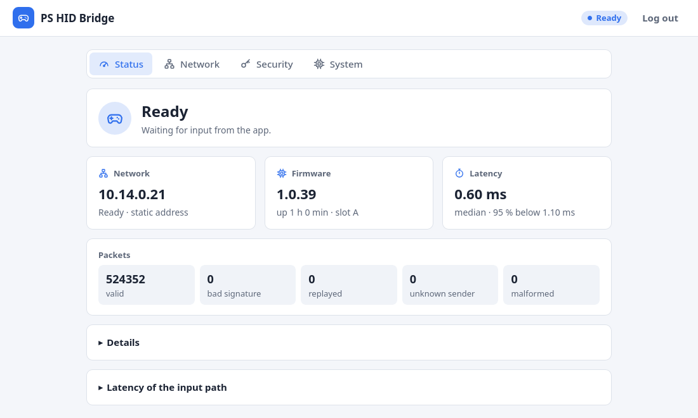
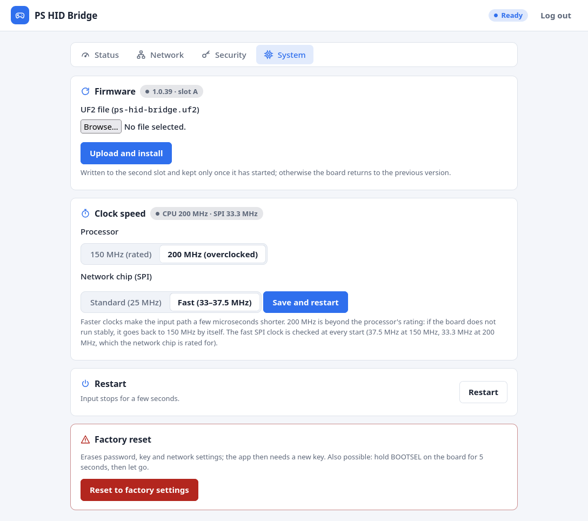
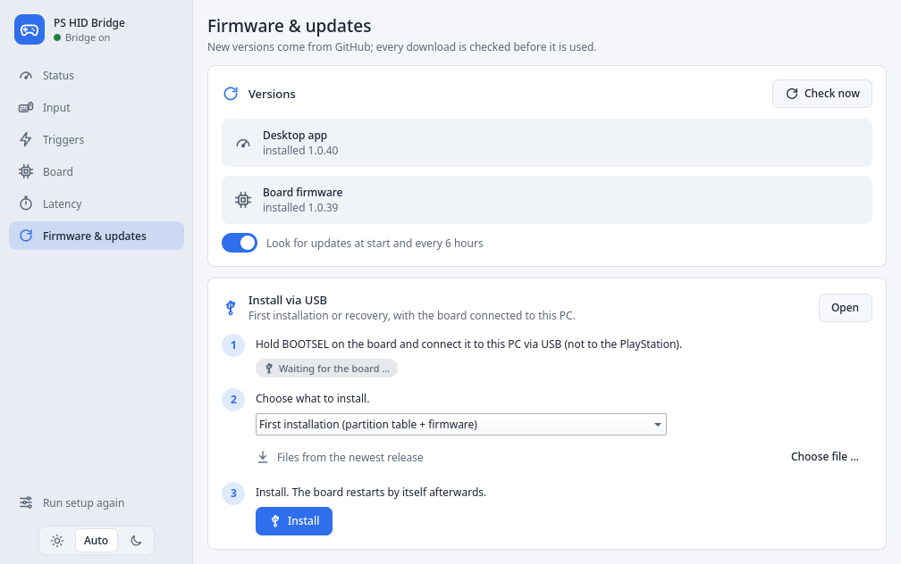

# Advanced setup

Everything the [README](../README.md) leaves out for everyday use: the command line tool, the board's web interface in detail, how firmware updates and recovery work, the image files, and setting things up by hand. What the encryption and the key protect against is in [security.md](security.md).

## Command line tool

`pshb-cli` (in the release as `pshb-cli-x86_64-linux` and `pshb-cli-aarch64-linux` for ARM64, built as `out/pshb-cli`) does what the app does, without a user interface. `pshb-cli run` also keeps the screen on while the bridge is on, and follows the window rule and the profiles' windows like the app.

```sh
pshb-cli list-devices                              # keyboards, mice, touchpads, touchscreens with access status
pshb-cli discover                                  # boards in the network: name, address, MAC, firmware (no key needed)
pshb-cli board --name "Living room"                # give the board a name ("" = default name)
pshb-cli config set --board 192.168.1.50 --device 046d:c52b --device "G Pro"
pshb-cli config set --keyboard ansi                # keyboard type: the key next to Enter sends HID 0x32 (iso) or 0x31 (ansi)
pshb-cli config set --touchpad-speed 1.5 --tap-to-click on --natural-scroll off
pshb-cli config set --window-rule-enabled on --window-rule chiaki-ng   # bridge on while that window has the focus
pshb-cli config set --sensitivity 1.5 --invert-y on --y-ratio 0.8 --wheel-speed 0.5   # mouse of the profile "Standard"
pshb-cli config set --profile Shooter --sensitivity 2   # ... of another profile
pshb-cli config set --active-profile Shooter       # the profile in use
pshb-cli config set-psk <64 hex digits>            # store the key
pshb-cli pair --password <web password>            # let the board make a new key and store it ("-": read the password from stdin)
pshb-cli pair --password ps-hid-bridge --new-password <own one>   # a new board: set its password first
pshb-cli config show                               # current settings
pshb-cli ping                                      # connection and board status
pshb-cli run                                       # forward; toggle with Ctrl+Alt+P
pshb-cli run --stats                               # also print the input latency every 5 s
pshb-cli type "text"                               # type text on the PlayStation ("-": from stdin; --layout us|uk|de)
pshb-cli diag --output report.md                   # the diagnostics report (as "Save diagnostics" in the app)
pshb-cli update --check                            # installed and newest versions (also of the board)
pshb-cli update                                    # replace pshb-cli with the newest release
pshb-cli update --firmware                         # install the newest firmware on the board
pshb-cli update --firmware --file ps-hid-bridge.uf2  # ... or a file
pshb-cli board                                     # latency of the board's input path, status, clock
pshb-cli board --cpu 200 --spi fast                # set the clock speeds (the board restarts)
pshb-cli flash                                     # first installation over USB (BOOTSEL), see below
pshb-cli flash --image erase                       # recovery images: firmware, hidtest, hidtest-mouse8, erase
```

`pshb-cli type` and `pshb-cli pair` take the key and the board's address like `ping`; `type` refuses while the app runs with the same key (the bridge is the app's then: use its "Type text" card). Profiles, their windows and remapped keys are edited in the app or in the settings file (below).

Key names in combinations follow the **position on a US keyboard** (`Z` is the `Y` key on a German keyboard). Modifiers: `Ctrl`, `Alt`, `AltGr`, `Shift`, `Super`; mouse buttons: `Mouse4`, `Mouse5`, `MouseMiddle`. The German names of earlier versions (`Strg`, `Umschalt`, `Maus4` …) are still accepted.

`pshb-cli replay FILE` plays input from a text file through the same logic as real devices (`make test` uses this against the simulator):

```
combo Ctrl+Alt+P      # press and release the combination
wait 30               # milliseconds
key LEFTSHIFT down
tap H
key LEFTSHIFT up
move 30 -10           # mouse
wheel 1
button BTN_LEFT down
focus on              # window rule: the window has the focus
```

## Settings and key files

Settings: `~/.config/ps-hid-bridge/config.toml`, key: `~/.config/ps-hid-bridge/psk` (readable by the user only). The app and `pshb-cli` share them.

Profiles in the settings file: `[mouse]` and `[[remap]]` at the top are the profile "Standard" (as before profiles existed, so older versions still read them); every further profile is a `[[profiles]]` table:

```toml
active_profile = "Shooter"      # chosen by hand ("" = Standard)
language = "de"                 # the app's language: en or de
ps_layout = "de"                # keyboard language of the PlayStation, for typing text ("" = from the system)

[mouse]
sensitivity = 1.0
accel = 0.0
threshold = 2.0
invert_y = false
y_ratio = 1.0                   # vertical speed relative to the horizontal one
wheel_speed = 1.0

[[remap]]                       # in the profile "Standard"
from = "CAPSLOCK"
to = "Ctrl"

[[profiles]]
name = "Shooter"
window = "chiaki-ng"            # applies while that window has the focus ("" = only by hand)
[profiles.mouse]
sensitivity = 2.0
invert_y = true
[[profiles.remap]]
from = "Mouse4"
to = "F"                        # "none": the key reaches the PlayStation not at all
```

A trigger chooses a profile with `action = "profile:Shooter"` or `action = "next-profile"`.

The project used to be called PS5 HID Bridge: settings, key and packet counter under the old name (`~/.config/ps5-hid-bridge`, `~/.local/state/ps5-hid-bridge`) move to the new folders on the first start, and "Set up access" replaces the old udev rule file.

## Device access by hand

"Set up access" in the app (see [Device access](../README.md#device-access)) writes a udev rule for **the selected devices and every keyboard**; the keyboards are needed so that triggers and the emergency stop work on all of them:

```
# /etc/udev/rules.d/70-ps-hid-bridge.rules
SUBSYSTEM=="input", KERNEL=="event*", ENV{ID_INPUT_KEYBOARD}=="1", TAG+="uaccess"
SUBSYSTEM=="input", KERNEL=="event*", ATTRS{id/vendor}=="046d", ATTRS{id/product}=="c52b", TAG+="uaccess"
```

This lets the logged-in user's programs read every keyboard (as with the selected devices).

To write it by hand: `pshb-cli list-devices` shows vendor and product ID in the "ID" column; afterwards run `sudo udevadm control --reload && sudo udevadm trigger -s input`. The file name must start with a number below 73, otherwise `uaccess` has no effect. Alternative: `sudo usermod -aG input $USER` and log in again (access to all input devices).

To remove it by hand: `sudo rm /etc/udev/rules.d/70-ps-hid-bridge.rules`; the access then ends when the devices are plugged in again or the computer restarts ("Remove access" in the app takes it back right away).

## Board

### Web interface

At `http://<board IP>/`, light or dark like the browser. The tab is part of the address (`#status`, `#network`, `#security`, `#system`), so a reload or a bookmark opens it directly.

- **Login:** factory password `ps-hid-bridge`. On the first login you must set your own password (8–64 characters). After three failed attempts, the address they came from has to wait, growing up to 64 seconds.
- **Status:** state of the PlayStation connection and input, tiles for network, firmware and slot, and latency, packet counters; more under "Details".
- **Network:** DHCP or static address, UDP port. Saving restarts the board.
- **Security:** generate a pre-shared key (shown exactly once) or enter an existing one, sender filter (one address such as `192.168.1.20` or a subnet such as `192.168.1.0/24`), change the password.
- **System:** firmware update, clock speed (CPU 150 or 200 MHz, SPI to the network chip standard or fast; see [latency.md](latency.md), "Clock speeds"), restart, factory reset.



Open it by the board's address or its name `ps-hid-bridge-XXXXXX` (also with the router's domain, e.g. `ps-hid-bridge-a1b2c3.fritz.box`); other names are refused (421), so no web page can pass itself off as the board through its own DNS name. The web interface uses unencrypted HTTP in the local network (see [security.md](security.md)).

### Network and LED

The board gets an address via DHCP and registers as `ps-hid-bridge-XXXXXX` (last six digits of the MAC address), or under the network name made from the name you give it (web interface "Network" → "Board name", the app's "Board" page, or `pshb-cli board --name "Living room"`): "Wohnzimmer PS5" becomes `wohnzimmer-ps5`. The router learns a new name at once, with a lease renewal; the board answers to both names in the browser. It also answers as `http://<network name>.local` (mDNS, e.g. `http://wohnzimmer-ps5.local`) and announces its web interface as an `_http._tcp` service under its board name; the web interface's Status tab shows that address under "Also at". If another device in the network already uses the name, the board takes its default name (`ps-hid-bridge-XXXXXX.local`); if both are taken, it answers to neither and tries again every minute. UDP port 5353 (mDNS) cannot be the input port. It receives input on UDP port 45045 and answers the app's search on UDP port 45046 ([SPEC.md](../protocol/SPEC.md#discovery)). When the board gets another address from DHCP while the app sends to it, the board tells the app first, from its old address (protocol MOVED), and the app sends to the new one at once: the bridge stays on, nothing is let go. Without that notice (older firmware, a lost packet, an address that ran out while the board was unplugged), the app looks for the board after 1.5 s without an answer (3 s with the bridge off): by its MAC address, which it remembers (`board_mac` in the settings), and by its name. An address from a name counts only where the board answers with its MAC address: a DNS or mDNS cache may still give the old one. Once the board's `.local` name leads to it on your PC, the app keeps the name instead of the address in its settings (`board`), with the address it answered at last (`board_ip`) to start at while it looks the name up. `pshb-cli run` and `replay` follow the board the same way (`--discovery-host` asks particular addresses instead of the whole network). A fixed address for the board in your router (DHCP reservation) avoids the change altogether.

LED: blinks slowly = no USB host, blinks fast = USB present but no IP yet, steady = ready (flickers briefly on input).

Watchdog: if one of the board's two cores hangs (core 1 runs network and web interface, core 0 the input path), the board restarts within a few seconds; the web interface then says "restarted by the watchdog". If core 1 hangs while it holds the bus to the network chip, core 0 does not wait for it: input is let go after 250 ms as with any loss of packets.

Console: UART0 (GP0/GP1, 115200 baud). The USB ID `1209:0001` is the pid.codes test PID and meant for private use only.

### Firmware update over the network

Web interface → System → upload `ps-hid-bridge.uf2`. The board writes the new firmware into the second slot (A/B), checks checksum and content and starts it "on trial". Only when it has run by itself for a few seconds is it accepted permanently. If it does not start properly, the board returns to the previous version after a restart. Every new firmware carries a higher version; the boot ROM always starts the newer one.

This needs the partition table from the first installation (`ps-hid-bridge-pt.uf2`, defined in [firmware/partitions/pt.json](../firmware/partitions/pt.json)). It divides the 2 MB flash into Firmware A (1000 KB), Firmware B (1000 KB) and an 8 KB area for the settings (key, password, network), so a new firmware can be written next to the running one, and no firmware file ever lands on the settings. A board flashed with only `ps-hid-bridge.uf2` has none: an update then overwrites the running firmware in place (it still works, but there is no previous version to fall back to). The web interface shows "no partition table" instead of the slot and the app warns on "Firmware & updates"; install it later with "Install via USB" → "First installation" (or copy both files via BOOTSEL). Key, password and network settings stay, they live in their own flash area.

The System page shows when a newer firmware is available (your browser asks GitHub; the board itself cannot reach the internet) and links the file.



### Updates from the app and the command line

The desktop app and `pshb-cli update` install the newest release themselves (in the app: the banner on the Status page and the page "Firmware & updates"):

- **Where from:** the releases of [upchui/PS-HID-Bridge](https://github.com/upchui/PS-HID-Bridge/releases), found through `github.com/upchui/PS-HID-Bridge/releases/latest` over HTTPS (not the GitHub API, whose limit of 60 requests per hour is shared by everything behind the same internet address). Every download is checked against the release's `SHA256SUMS` before it is used.
- **App and CLI** replace their own file (written next to it, then renamed over it).
- **Board firmware** goes to the board over HTTP, signed with the pre-shared key instead of the web password: the board hands out a one-time challenge, and the app sends a MAC over the challenge and the file's hash, which the board checks before it writes anything (see [SPEC.md](../protocol/SPEC.md), "Firmware update with the key"). Boards from 1.0.9 on need an app from 1.0.9 on for this; the app still updates older boards. Then it waits until the board runs the new version; if the board returned to the old one, it says so.
- The app looks for updates at start and every six hours and only installs on a click; `pshb-cli config set --update-check off` (or the switch in the app) turns the check off.

### Flashing over USB from the PC

For the first installation or for recovery, the app ("Firmware & updates" → "Install via USB", also offered on the first page of the setup wizard) and `pshb-cli flash` do what the README's [Quick start](../README.md#quick-start) describes by hand: hold BOOTSEL while connecting the board to the PC via USB, and the board shows up as the drive `RP2350`. The program finds that drive through UDisks2 (the service file managers use; no root needed), mounts it if necessary, checks `INFO_UF2.TXT`, copies the files and waits for the board to take them:

- **First installation** (`--image first-install`, the default): partition table, then — after the board came back as a drive — the firmware.
- **Firmware only**, the **HID test images** and **Erase everything** (`--image firmware`, `hidtest`, `hidtest-mouse8`, `erase`): see [Other images](#other-images). Erasing asks first (in the CLI unless `--yes`).
- The files come from the newest release (checked against `SHA256SUMS`); "Choose file …" in the app or `--file X.uf2` uses your own file instead (for the first installation it replaces the firmware, the partition table still comes from the release). Only UF2 files for the RP2350 are accepted.



If the board is not found: use a USB cable with data lines, hold BOOTSEL *while* plugging in, and check that `udisks2` runs (`systemctl status udisks2`).

### Factory reset and recovery

- **Factory reset:** in the web interface, or hold the BOOTSEL button for 5 seconds while the board is running, then let go: the board restarts with factory settings. Password, key and network settings are erased.
- **Reflashing always works:** hold BOOTSEL while plugging in and copy a UF2 file.
- **Erase everything:** copy `ps-hid-bridge-nuke.uf2` via BOOTSEL. It erases the whole flash and returns to the drive; then install partition table and firmware again.

### Other images

The app and `pshb-cli flash` can put the firmware, the HID test images and the erase image on the board over USB (see above).

| File | Purpose |
|---|---|
| `ps-hid-bridge.uf2` | normal firmware |
| `ps-hid-bridge-pt.uf2` | partition table (once, before the first firmware) |
| `ps-hid-bridge-hidtest.uf2` | no network: 5 s after plugging in, the mouse moves in a square |
| `ps-hid-bridge-hidtest-mouse8.uf2` | the same with 8-bit mouse axes, in case a host dislikes the 16-bit descriptor |
| `ps-hid-bridge-plain.uf2` | **bring-up only:** also accepts unencrypted packets |
| `ps-hid-bridge-rollbacktest.uf2` | **testing only:** never confirms itself after an update, the board must return to the previous version |
| `ps-hid-bridge-timing.uf2` | **measuring only:** normal firmware plus measuring pins GP2/GP3 (not with a USB socket soldered there, see [usb-host-port.md](usb-host-port.md)), a latency summary on the UART every 10 s and an upload sink for load tests (`tools/fw_bench.py`, see [latency.md](latency.md)) |
| `ps-hid-bridge-nuke.uf2` | erases the whole flash |

## Installing with Shelly

[Shelly](https://github.com/Seafoam-Labs/Shelly-ALPM), CachyOS's package manager, installs AppImages: it copies the file to `~/.local/bin`, adds the app to the application menu with its icon and lists it with its version.

- **The app offers it:** started as an AppImage on a system with Shelly (a download, the Desktop), the Status page and the wizard's first step offer "Install with Shelly"; afterwards "Restart" continues with the installed copy, and the file you started can be deleted. "Later" hides the offer until the next start. Is the app installed already and this is another file, it offers to start the installed one instead. Running the installed copy, it offers nothing. The app is then in the menu under Games: Shelly refreshes the desktop database, and the app also rebuilds KDE Plasma's menu cache (`kbuildsycoca6`), which Shelly does not.
- **By hand:** `shelly install appimage PS-HID-Bridge-x86_64.AppImage`, or drag the file into Shelly.
- **Updates:** the app updates itself as everywhere ("Update app"), in place, and then has Shelly read the file again (`shelly sync appimage <name>`), so Shelly lists the version that runs. The AppImage carries no update information of its own (Shelly would rename the file and update it a second time); Shelly reads the version from `X-AppImage-Version` in the AppImage's desktop entry.
- **Removing:** first "Remove system changes" on the app's "Firmware & updates" page ("Before uninstalling", administrator password once): it removes the rules the app set up as root, `/etc/udev/rules.d/70-ps-hid-bridge.rules` (device access) and `70-ps-hid-bridge-latency.rules` (low latency), and takes back the access they gave. Shelly cannot do that: it never runs as root. Then remove the app in Shelly, or `shelly remove appimage PS-HID-Bridge-x86_64`: the AppImage, its menu entry and its icon go.
- **Settings:** the app's button keeps them. Shelly's "Remove configuration files" (`--remove-config`) deletes the folders named like the app's menu entry, "PS HID Bridge": `~/.config/ps-hid-bridge` (settings and key), `~/.local/state/ps-hid-bridge` (packet counter) and `~/.cache/ps-hid-bridge`. Without it they stay, and a reinstalled app finds them again.

The app calls Shelly with the AppImage's own library and plugin paths taken out of the environment, so Shelly runs with the system's libraries. What it found is in the diagnostics report ("Shelly: installed as …").

## Downloads and version numbers

Every commit on `main` is built and tested automatically and published as a release on the [releases page](https://github.com/upchui/PS-HID-Bridge/releases), named after its version, e.g. `v1.0.3`; the newest one is marked "Latest". Each release contains the AppImage and the command line tool for x86_64 and for ARM64 (`PS-HID-Bridge-x86_64.AppImage`, `PS-HID-Bridge-aarch64.AppImage`, `pshb-cli-x86_64-linux`, `pshb-cli-aarch64-linux`), all firmware images and `SHA256SUMS`. The app and the CLI update themselves with the file for their own processor.

The last part of the version is the number of commits since the version (`1.0`) was raised, so every commit has a higher version than the one before. The app, `pshb-cli --version` and the firmware (web interface, "Status" page of the app) all show the same version.

## Keeping the screen on

While the bridge is on, the desktop sees no input from the grabbed mouse and keyboard and would dim the screen, turn it off and lock it. The app asks it not to, through D-Bus (`org.freedesktop.ScreenSaver`, else the desktop portal's idle inhibition, e.g. on GNOME), until the bridge switches off, pauses or the app quits. Plasma lists PS HID Bridge in the power applet meanwhile. `pshb-cli run` does the same.
