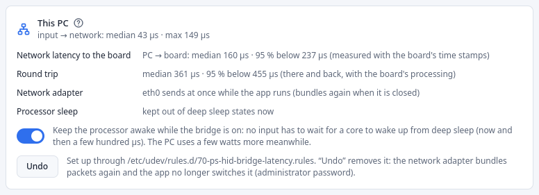
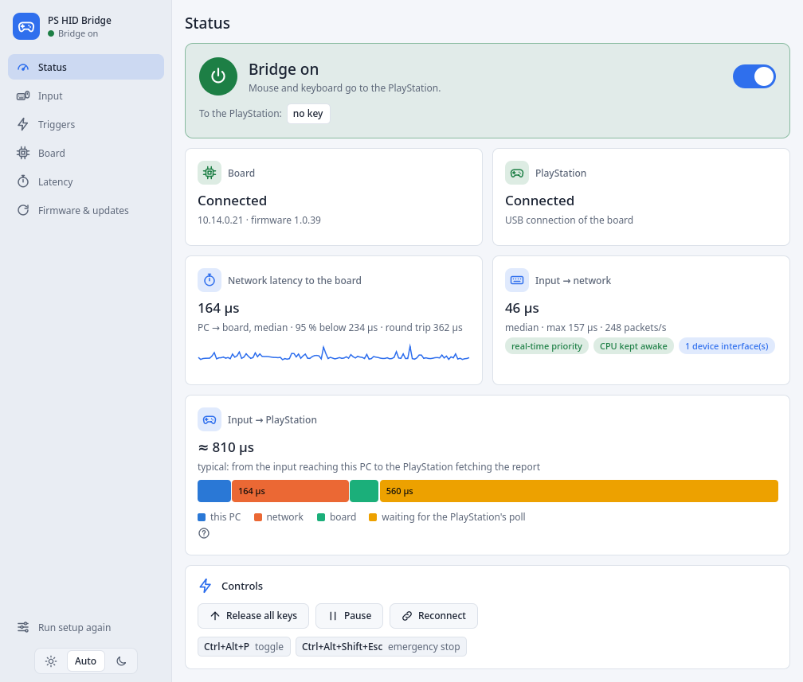

# Latency: this PC, the network, and measuring

What the app does to keep the way from the input to the board short, how to undo the system settings it makes for that, and how to measure the whole path. The overview is in the [README](../README.md#latency); the board's input path, from the datagram to the USB report, stage by stage, is in [latency.md](latency.md).

The input path takes about 1–2 ms from a key press or mouse movement to the PlayStation; the video path (PlayStation encoder → network → chiaki-ng → display) takes tens of milliseconds. The input path is built to stay short even when the PC is busy.

## App

One thread waits on all selected devices, runs the trigger logic and sends the packet itself, without handing the event to another thread. It runs with real-time priority (through rtkit, which desktops with PipeWire usually have, or directly if the user may use `SCHED_FIFO`, e.g. via a `realtime` group). If neither works, the status page says "normal priority".

## Processor sleep

Idle cores of a modern CPU sleep in states that take long to wake up from (laptops in particular). Most wake-ups are fast anyway, but now and then one takes a few hundred microseconds (measured on a laptop, waking a waiting thread from another core: median 7 µs either way, slowest 290 µs → 45 µs with the request below). While the bridge is on, the app keeps them out of these states (PM QoS request through `/dev/cpu_dma_latency`: wake-up within 20 µs, light sleep stays allowed); when the bridge is off, they sleep as usual. The PC uses a few watts more meanwhile; switch it off on the Latency page ("This PC") or with `keep_cpu_awake = false` in the settings file. Switching needs no root: the app opens and closes the device itself. It belongs to root on many systems, though (on some to the group `audio`, which may use it anyway): there "Set up" on the Latency page adds a line to `/etc/udev/rules.d/70-ps-hid-bridge-latency.rules` that lets the logged-in user use it. `pshb-cli run` does the same.

## Network

Packets are marked DSCP EF, so Wi-Fi sends them in the voice queue. A cable is still better: connect the PC and the PlayStation by cable and the board to the same switch.

## USB network adapters

USB network adapters with the `cdc_ncm` driver (many USB-C docks and USB Ethernet adapters, e.g. ASIX AX88179) hold every outgoing packet back to bundle it with others: a lone packet waits up to three rounds of the driver's timer, by default 3 × 400 µs, before it goes out. "Input → network" does not see this (it ends when the packet is handed to the network stack); the round trip does (a ping to the router above 1 ms on a cable).

The setting belongs to the adapter, not to a program, so the app switches it only while it runs: `tx_timer_usecs` 0 when it starts, back to the old value (400) when it is closed (a crash is put right at the next start). Writing it needs root, so it is set up once: the app notices such an adapter on the way to the board and offers "Set up" (status page, administrator password). The udev rule `70-ps-hid-bridge-latency.rules` then hands `tx_timer_usecs` of such adapters to your user, now and whenever one is plugged in; after that the app switches without a password.

By hand: `sudo chown $USER /sys/class/net/eth0/cdc_ncm/tx_timer_usecs` (until the adapter is plugged in again).

While the app runs, other programs' packets through the adapter go out at once too; large downloads cost a little more CPU time then. `pshb-cli run` switches it the same way while it runs.

## Undoing it

"Undo" on the Latency page ("This PC", administrator password), or "Remove system changes" on "Firmware & updates" together with the device access rule, removes `70-ps-hid-bridge-latency.rules`, gives the adapters' setting back to root (at the driver's 400 µs) and takes back the permission for `/dev/cpu_dma_latency` (unless the system grants it anyway, e.g. to the group `audio`).

By hand: `sudo rm /etc/udev/rules.d/70-ps-hid-bridge-latency.rules`, then plug the adapter in again; the permission ends with the next restart.

## The board

Core 0 handles nothing but USB and the input socket; network management and the web interface run on core 1. From the W5500's interrupt to the input being ready for the next report takes 52–56 µs (median, SPI at 25 MHz): the datagram comes in by DMA while both cores decrypt it, and core 1 gives the SPI bus to core 0 after at most one 128-byte piece. Details, measurements and the way there: [latency.md](latency.md).

## Measuring

- **App, status page:**
  - "Input → network": the kernel time of the event until the packet is sent, with median, 95 % and maximum.
  - Whether the processor is kept awake.
  - "Network latency to the board": the time a packet takes from this PC to the board (PC → board), with the round trip (there and back) underneath. Answers to pings sent before the board answered for the first time (address resolution still running) stay out of these statistics.
  - "Input → PlayStation": adds up the medians of the whole way from the input reaching this PC to the PlayStation fetching the report (this PC, network, board, waiting for the PlayStation's poll).

  The Latency page sums it up under "This PC". On the command line: `pshb-cli run --stats`.
- **PC → board time:**
  - The exact time needs board firmware that answers timed pings (PING_TIMED, see [SPEC.md](../protocol/SPEC.md)). The board notes when a ping arrived (the network chip's interrupt) and when it answered, so its processing time comes out of the round trip.
  - PC and board have no common clock. The app works out the offset between the two (and how it drifts) from the fastest answers, assuming those took equally long both ways. Delays on the way out (a busy uplink, an adapter that bundles packets) then show where they happen. If even the fastest answers took longer one way, the estimate is off by half the difference.
  - With older firmware the app shows half the round trip instead, marked "≈".
  - A plain `ping` to the board is answered by the network chip itself and leaves out the firmware.
- **Board, web interface (Status):**
  - "Latency" shows the time from a packet to the report fetched by the PlayStation.
  - "Latency of the input path" shows every stage (median, 99 %, slowest), the wait for the SPI bus, missed polls and the polls the PlayStation skipped, with a button to start over.
  - The app shows the same as charts on its Latency page.
  - `tools/fw_bench.py` drives such measurements under load (see [latency.md](latency.md)).
- **Mouse reports and the PlayStation's poll:**
  - Mouse reports are filled shortly before the PlayStation fetches them (once per millisecond), not right after the previous fetch.
  - The board learns when the fetches happen and fills the report about 100–150 µs before. The lead is at least as long as its main loop was busy at most lately (receiving and decrypting a datagram) plus 20 µs, so the report carries all motion up to then.
  - On average an input waits half a millisecond plus that lead.
  - A poll the PlayStation skips (about 1 %) is counted but does not make the lead longer.
  - For comparison: `make firmware FW_CMAKE_ARGS=-DPSHB_MOUSE_LATE_ARM=OFF`.
- **The app from outside:**
  - `tools/latency_bench.py --cli out/pshb-cli --vendor VVVV --product PPPP [--load 16]` creates a virtual mouse via `/dev/uinput`, plays the board and reports percentiles, optionally with busy processes on every core.
  - It needs write access to `/dev/uinput` and read access to the virtual device (`--vendor`/`--product` of a device that your udev rule covers).
  - Typical on a desktop with real-time priority: median about 0.1 ms, 99 % below 0.3 ms, also with every core busy.
