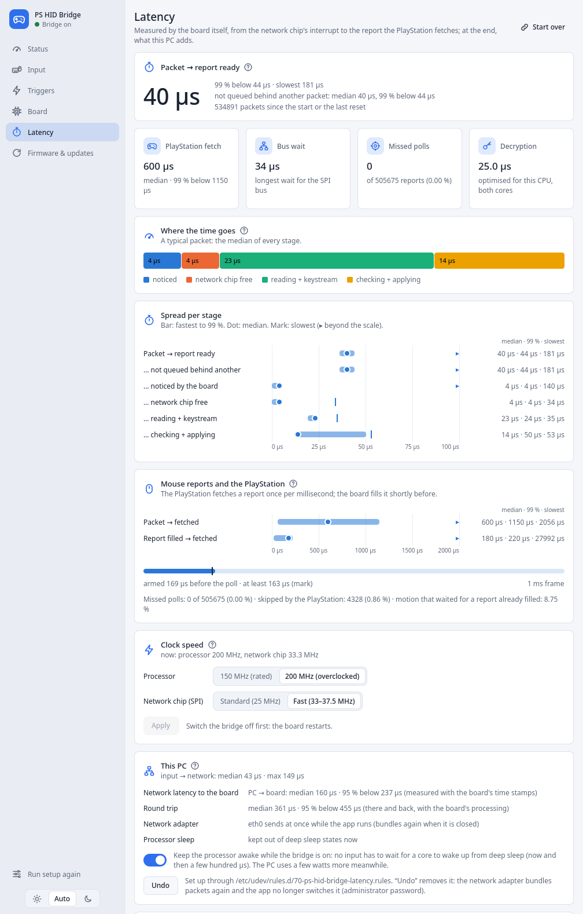
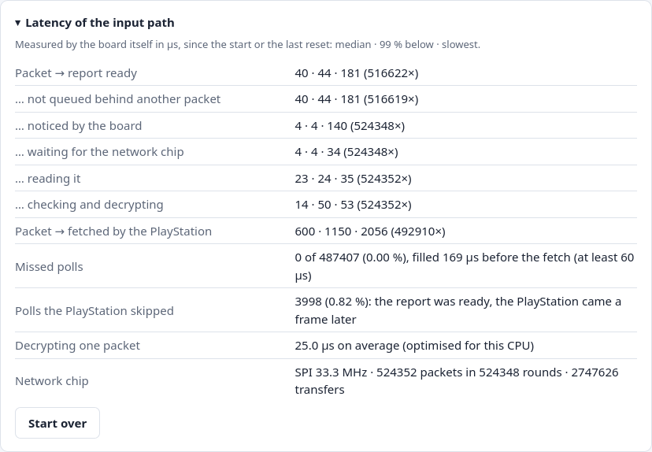

# Board input path: from UDP packet to HID report

How long the board needs from "a datagram from the app arrives at the W5500"
to "its input is ready for the next USB report", how steady that is, and how
it got there. Firmware 1.0.13 (before) to 1.0.24 (after), each change its own
commit with its numbers in the message.

## The stages

```
W5500 INTn falls ──► noticed by core 0 ──► SPI bus acquired ──► datagram read
   (GPIO IRQ stamp)     "detect"              "bus"             "spi" (incl. both
                                                                 ChaCha20 blocks)
 ──► tag checked, decrypted, applied ──► report armed ──► fetched by the host
       "handle"                            (lead before      "usb", "armed"
                                            the poll)
 "ready" = INTn → applied ("packet → report ready")
 "ready1" = the same for the first datagram of a receive round, i.e. not
            queued behind another datagram (WLAN delivers packets in bunches)
```

Every stage is a histogram on the board (`time_us_64()`, 1 µs; min, median,
P99, max; percentiles are bucket upper edges), shown under "Latency of the
input path" in the web interface, on the app's Latency page and in
`GET /api/diag`.





## Method

- `tools/fw_bench.py` (runs in the firmware Docker image with `--network host`):
  logs in, optionally installs an image over the network, resets the
  statistics, sends 1000 encrypted INPUT packets per second (mouse ±1, as a
  1000 Hz mouse through the app would) and reads the board's measurements.
  Scenarios, 30 s each:
  - **S0** idle (no packets), **S1** mouse,
  - **S2** mouse + web interface (pages, scripts and status in a loop),
  - **S3** mouse + uploads to `/api/bench/sink`, the network side of a
    firmware upload without flash writes or a restart.
- Image: `ps-hid-bridge-timing.uf2` (the normal firmware plus GPIO measuring
  points, a UART summary and the upload sink).
- Setup: board 10.14.0.21 at a running PlayStation 5 (USB host polling every
  millisecond), packets from a PC over **WLAN**.
- No logic analyzer: the GPIO measuring points (GP2: INTn noticed → applied,
  GP3: toggles on every mouse report fetched, `PSHB_TIMING_GPIO`) are in the
  timing image but were not used for these numbers.

WLAN matters: at some times it delivers packets evenly (1.02–1.05 datagrams
per receive round), at others in bunches (up to 1.3 per round, and after a
radio pause dozens at once). A datagram queued behind others waits for them,
so the P99 of "ready" (all datagrams) depends more on the radio than on the
board; "ready1" (first datagram of a round) is the board's own path. Where it
mattered, images were compared back to back on the same network.

## Starting point (1.0.13)

| | mouse | + web | + upload |
|---|---|---|---|
| packet → ready, median / P99 / max (µs) | 106 / >256 / 1107 | 106 / >256 / 1802 | 106 / >256 / 1483 |
| core 0 waits for the bus, P99 / max (µs) | 4 / 5 | >256 / 393 | >256 / 392 |
| packet → fetched, median / P99 (µs) | 1200 / 2200 | 1300 / 2450 | 1150 / 2200 |
| missed polls (as counted then) | 0.38 % | 0.56 % | 0.40 % |
| lead before the poll | 500 µs (the maximum) | 500 µs | 500 µs |
| SPI transactions by core 0 when idle | 3052/s | | |

Per datagram: SPI 47 µs (≈ 7 transactions at 25 MHz), checks + decryption +
apply 54 µs (decrypting one 49-byte packet with Monocypher: 52.9 µs).

## Changes

| Commit | Change | Effect (before → after) |
|---|---|---|
| Measuring points | stages, INTn timestamp, `/api/diag`, timing image, fw_bench | (baseline above) |
| Receive only on INTn | no 1 ms poll; INTn is level-triggered; leftovers of a round continue without waiting | idle SPI 3052/s → 0/s; detect P99 >128 → 5 µs; packet → fetched median 1200 → 800 µs |
| Fewer SPI transactions | size read once (torn reads handled), read pointer + RECV once per round after applying, no wait for Sn_CR | ~7 → ~5 transactions; SPI 47 → 32 µs; ready median 106 → 92 µs |
| Bus in pieces | ioLibrary buffer transfers in 128-byte pieces, core 0 has priority | bus wait max with web / upload load 394 / 392 → 55 / 52 µs |
| 37.5 MHz option | fast SPI clock with a self-test, default stays 25 MHz (now a setting, see "Clock speeds") | (option) SPI 32 → 24 µs |
| Faster decryption | own RFC 8439 AEAD (Poly1305 26-bit limbs), ChaCha20 block in Cortex-M33 assembly, word-wise wiping | decrypt 52.5 → 33.2 µs; ready median 92 → 76 µs |
| SPI mode 3 | the PL022 sends bytes back to back (mode 0 leaves gaps) | SPI 32 → 28 µs; ready median 76 → 72 µs |
| Decrypt while it arrives | datagram by DMA, both ChaCha20 blocks computed from the header while the rest arrives; small accesses straight on the SPI registers | ready median 72 → 60 µs |
| Mouse report timing | missed polls counted correctly, skipped host polls separately, lead floor from the main loop's longest absence | lead 500 → 95..135 µs; missed polls → 0; packet → fetched P99 2200..2400 → 1100..1150 µs |
| Two cores | core 1 computes the second ChaCha20 block (doorbell interrupt, fallback after 6 µs) | ready median 60 → 52..56 µs |

## Result (1.0.24)

| | mouse | + web | + upload |
|---|---|---|---|
| **packet → ready**, median / P99 / max (µs) | 52 / 152 / 2360 | 56 / 152 / 1009 | 56 / 148 / 301 |
| **… first datagram of a round**, median / P99 / max (µs) | 52 / 106 / 208 | 54 / 106 / 181 | 54 / 106 / 180 |
| **core 0 waits for the bus**, P99 / max (µs) | 4 / 4 | 44 / 46 | 36 / 45 |
| **missed polls** | 0 of 24271 | 0 of 25065 | 0 of 25369 |
| polls the PlayStation skipped | 0.87 % | 0.62 % | 0.60 % |
| lead before the poll | 95 µs | 131 µs | 121 µs |
| packet → fetched, P99 / max (µs) | 1150 / 3386 | 1100 / 1720 | 1100 / 1778 |
| SPI transactions by core 0 when idle | 0/s | | |

With the fast SPI clock (37.5 MHz, self-test passed, no bad signatures):
packet → ready median 52 µs, first datagram of a round median 50 µs, P99
100 µs; bus wait max 33 µs (web) / 31 µs (upload).

### Clock speeds

Both clocks are settings (web interface → System → Clock speed, the app's
Latency page, `pshb-cli board --cpu 150|200 --spi standard|fast`); the board
restarts to apply them. 200 MHz is beyond the RP2350's rating: a start at
200 MHz is on trial for 10 s under the hardware watchdog, and if it hangs,
the next start runs at 150 MHz and stores that. At 200 MHz the peripheral
clock follows the CPU, so the fast SPI clock is 33.3 MHz, which the W5500 is
rated for.

| 1.0.25 at 200 MHz, SPI 33.3 MHz | mouse | + web | + upload |
|---|---|---|---|
| packet → ready, median / P99 / max (µs) | 40 / 84 / 1377 | 40 / 100 / 382 | 40 / 84 / 186 |
| … first datagram of a round, median / P99 (µs) | 40 / 78 | 40 / 78 | 40 / 80 |
| core 0 waits for the bus, max (µs) | 4 | 35 | 34 |
| missed polls | 0 | 0 | 0 |

Decrypting one packet takes 24.8 µs there (33 µs at 150 MHz). With that
setting both latency targets are met.

The median of "packet → fetched" (500–800 µs) depends on where the test
sender's packets fall within the PlayStation's frame (both run at 1 kHz); for
input at random times the average is half a frame plus the lead, now about
0.6 ms instead of about 1.0 ms with the old 500 µs lead. That is the biggest
gain for the player: ~400 µs on average.

### Against the targets

| Target | Result |
|---|---|
| packet → report ready < 50 µs median | **52–56 µs** at 25 MHz, 50–52 µs at 37.5 MHz: close, not quite; **40 µs** with the CPU at 200 MHz |
| … < 100 µs P99 | **106 µs** (first datagram of a round) at 25 MHz, 100 µs at 37.5 MHz, **78–80 µs** at 200 MHz; over all datagrams 148–152 µs at 150 MHz because WLAN bunches queue behind each other |
| core 0 waits for the bus < 0.1 ms | **met**: at most 46 µs with web load, 45 µs during uploads |
| missed polls near 0 with continuous motion | **met**: 0 in ~75000 reports (the ~0.6–0.9 % skipped polls are the PlayStation's) |

### Where the remaining ~52 µs go (25 MHz, first datagram)

| Part | µs |
|---|---|
| INTn → noticed (main loop) | 2–4 |
| bus, acknowledge the interrupt, read size and read pointer | ~5 |
| first 21 bytes of the datagram by DMA (UDP header + packet header with the nonce) | ~7 |
| both ChaCha20 blocks, one per core, while the rest arrives | ~12 |
| Poly1305 tag (4 blocks), XOR, checks, apply | ~19 |

The CPU is the limit now, not the SPI bus: the Cortex-M33 runs this firmware
from SRAM (on purpose, so flash writes never stall the input path), where
instruction fetch and data share one bus, at about 1.9 cycles per
instruction. One ChaCha20 block takes 10 µs (≈ 1500 cycles), the Poly1305
part 14 µs.

## Tried, measured and left out

- **Compiler options for Monocypher:** -O3 (in use) 52.9 µs per packet, -O2
  60.6 µs, -Os 74.5 µs.
- **ChaCha20 in SCRATCH_X** (a RAM bank only core 0 runs code from):
  10.3 instead of 10.0 µs per block; bank conflicts are not the cost.
- **DMA alone:** the wire time stays the same and core 0 has nothing else to
  do; DMA only pays off together with decrypting while the data arrives.
- **33 MHz SPI:** not possible from the 150 MHz peripheral clock (even
  divider: 25 or 37.5 MHz). 37.5 MHz is above the 33.3 MHz the datasheet
  guarantees and therefore an option with a self-test, not the default.
- **Not done:** Poly1305 in assembly (UMAAL), Poly1305 over the header
  while the data arrives; each would bring a few µs. A higher CPU clock
  came later as a setting (see "Clock speeds").

## Measuring yourself

```sh
make firmware                       # out/ps-hid-bridge-timing.uf2
make image-firmware
docker run --rm -u $(id -u):$(id -g) --network host -v "$PWD":/work -w /work \
    -v /path/to/secrets:/secrets:ro -e HOME=/work/.cache/home pshb-firmware \
    python3 tools/fw_bench.py <board-ip> --password-file /secrets/web_password \
    --psk-file /secrets/psk --install out/ps-hid-bridge-timing.uf2 \
    --scenarios S0,S1,S2,S3 --seconds 30 --label mine
```

Switch the bridge in the app off meanwhile (the test sends its own input),
and leave the PlayStation on (USB polling). The JSON lands in `out/bench/`.
Install the normal `ps-hid-bridge.uf2` again afterwards.
