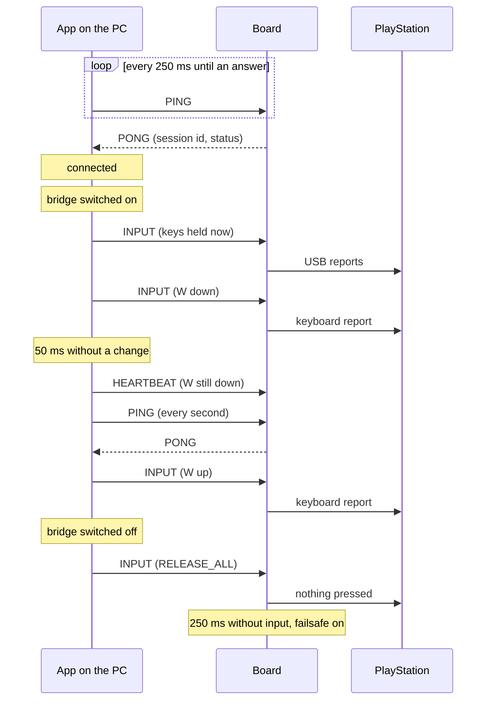

# How the app talks to the board

How the desktop app (and `pshb-cli`) and the board talk over the network: which packets go when, why it works this way, and what happens when something goes wrong. The exact byte layout of every packet is in [protocol/SPEC.md](../protocol/SPEC.md); this page explains it.

## In short

- **Small UDP packets.** The app sends your input to the board as UDP datagrams of 38 to 91 bytes, one per change, to the board's port **45045**. The board answers only pings. While you play, that is all the traffic; the web interface (HTTP, port 80) is only for setting up and updates.
- **No connection, no resending.** UDP never sends a lost packet again later, and nothing waits for it. That suits input: a key press that arrives 200 ms late is worse than one the next packet puts right a millisecond later. Keys and buttons always go as a whole state ("these keys are down now"), so the next packet repairs any loss.
- **Encrypted and signed.** Every packet is encrypted and signed with the key from the board's web interface (ChaCha20-Poly1305). The board drops whatever has no valid signature, is older than the last valid packet, or belongs to an earlier start of the board.

## The packets

| Packet | From → to | When | Size |
|---|---|---|---|
| **PING** | app → board | every second; every 250 ms until the board has answered once; every 200 ms while the app's Latency page is open | 38 bytes |
| **PONG** | board → app | the answer to a PING: the board's session, firmware version, uptime, USB state and its packet counts | 75 bytes |
| **INPUT** | app → board | on every change of keys, buttons, motion or wheel: all keys and buttons held now, plus the motion since the last packet | 49 bytes |
| **HEARTBEAT** | app → board | while the bridge is on and nothing was sent for 50 ms: the keys and buttons held now, no motion | 49 bytes |
| **PING_TIMED** | app → board | instead of PING, to boards that offer it (for the one-way time) | 38 bytes |
| **PONG_TIMED** | board → app | a PONG plus when the ping arrived on the board and when the answer left | 91 bytes |

Every packet has the same frame: a 10-byte header (version, type, counter) in plain text, then the encrypted content, then a 16-byte tag that signs both. The [example below](#example-one-input-packet-byte-by-byte) shows one byte by byte.

## From start to end

A normal session: the app starts, finds the board, you switch the bridge on, press and release W, switch it off again.



## Connecting

- **Finding the board.** The app knows the board's address and the key. It sends a PING every 250 ms until a PONG comes back. To learn the address in the first place, it asks the network on UDP port 45046: every board answers with its name, MAC address, firmware version and input port, unencrypted and without the key ([SPEC.md](../protocol/SPEC.md#discovery)). The app keeps the MAC address of its board and asks again when the board stops answering, so it follows a board that got another address. A board with current firmware says so first: before it takes another address from DHCP it sends **MOVED** from the old one, and the app switches without a pause.
- **The session.** The PONG carries the board's **session id**, a random number the board picks at every start. Every INPUT and HEARTBEAT names it; the board refuses input with another session. So nothing recorded before a board restart can be played back afterwards.
- **"Connected"** means a valid PONG within the last 3 seconds. Without one, the app shows "Board not reachable" and keeps pinging.
- **Which answers count.** A PONG counts only if it opens with the key and answers a ping the app sent within the last 2 seconds (it echoes that ping's send time). Other answers are counted and ignored.
- **Nothing old is sent.** Input from before the first PONG is not kept: when the bridge goes on, the first INPUT carries the keys held at that moment.

## Sending input

- **Keys and buttons are a state, not events.** Every INPUT carries all keys held at that moment (up to six, plus the modifier keys such as Shift) and all mouse buttons. If a packet gets lost, the next packet or heartbeat has the right state anyway.
- **Every change is sent, in order.** A key tapped for less than a millisecond still makes two packets, down and up, so the PlayStation sees the tap. Up to 64 changes can wait to be sent; should the app ever fall further behind, it drops the oldest.
- **Motion and wheels are relative.** The app adds up what the mouse reports until the next packet goes out. What does not fit into one packet (±32767 per axis, ±127 for the wheels) goes into the next one.
- **At most one packet per millisecond on average**, two in a row allowed. A 1000 Hz mouse whose reports come a little unevenly is never held back, and a burst of events cannot flood the network. Motion that has to wait meanwhile is added up.
- **Heartbeat.** While the bridge is on, a HEARTBEAT goes out whenever no INPUT or HEARTBEAT was sent for 50 ms (pings do not count). It tells the board that the app is still there and repeats the keys held.
- **Letting go.** Switching the bridge off sends one INPUT with the flag RELEASE_ALL, and the board lets go of everything. "Release all keys" and closing the app send it too.

## On the board

The board picks up each datagram as soon as the network chip signals it, up to four in a row before it turns to USB again. It checks every packet, cheapest check first:

| Check | Fails as | In the web interface (Status, "Packets") |
|---|---|---|
| 1. Right length, version and type | malformed | malformed |
| 2. Sender allowed (only with a sender filter, see [Network](#network)) | foreign sender | unknown sender |
| 3. Counter higher than in the last valid packet | replay | replayed |
| 4. Signature valid (right key) | bad signature | bad signature |
| 5. INPUT and HEARTBEAT: the current session | old session | replayed |

- **No answer to a failed packet.** A device without the key gets nothing back, not even an error. The board only counts it; the counts are also on the app's Latency page and in `pshb-cli ping` (every PONG carries them).
- **Only authentic packets move the counter.** A forged packet cannot push the counter up and lock the app out, because the counter only moves after the signature check.
- **Each change becomes its own USB report.** Every change of the keyboard state becomes one keyboard report, every change of the mouse buttons one mouse report, one per poll of the PlayStation (once per millisecond). Up to 8 changes of each kind can wait; if more come, the last one waiting is replaced by the newest.
- **Motion is added up** and goes into the next mouse report, which is filled shortly before the PlayStation fetches it (see [latency-pc.md](latency-pc.md#measuring)).
- **PINGs** are answered straight away, to the address and port the ping came from.
- **Failsafe.** If no valid INPUT or HEARTBEAT arrives for **250 ms**, the board lets go of every key and button. It does the same when the PlayStation disconnects the USB port or goes to rest mode. The next valid packet goes on as normal.

## When something goes wrong

| What happens | The board | The app |
|---|---|---|
| **A packet gets lost** | Nothing special: the next INPUT or HEARTBEAT, at the latest 50 ms later, brings the right keys. The motion in the lost packet is gone. | Nothing; it never sends a packet again. |
| **The network is gone** (cable, Wi-Fi) | Lets go of everything after 250 ms without valid input. | After 3 s without a PONG: "Board not reachable". It keeps sending and pinging. If the system refuses to send (e.g. the PC's address is gone), it opens the way to the board again, at most every 2 s. Once answers come back, input goes on. |
| **The board restarts** | Starts with a new session and refuses INPUT with the old one. To the first such packet (then at most every 100 ms) it answers with a PONG that names the new session: a *session hint*. | Pings at once. The answer to that ping switches it to the new session, and it sends the keys held now. The hint alone does not switch: it answers no ping, so a recorded hint could be played back. |
| **Wrong key** on one side | Drops every packet, counts "bad signature", answers nothing. | Gets no answer: "Board not reachable". The board's web interface shows "bad signature" counting up. |
| **The app restarts** | Nothing: the app's counter goes on above its last value (it comes from the clock and a floor stored on disk), so its packets stay valid. | — |
| **Two PCs send with the same key** | Takes whatever comes with a higher counter. The PC whose clock is behind gets most of its packets refused as "replayed". | Do not do this: switch the bridge off on one PC first. The counters come from the clock, so two PCs could use the same nonce (see [SPEC.md](../protocol/SPEC.md#nonce)). On one PC, a second program with the same key is refused. |
| **Someone floods the board** with packets | Drops them with the cheap checks first, before any decryption. A flood can still delay your input. | — |
| **The board is still busy sending** its previous answer | Drops the new answer. | The next ping gets one. |

What this means for you while playing: [docs/security.md](security.md#when-something-goes-wrong).

## Why it is safe

- **Encrypted and signed.** The content is encrypted and the whole packet, header included, is signed with ChaCha20-Poly1305 and the 256-bit key. The nonce is made of the direction and the counter, so app and board never use the same one.
- **Nothing can be played back.** The counter has to grow, and the board picks a new session at every start, so a recorded packet is worthless.
- **The key is in no packet.** You copy it once from the board's web interface into the app; no UDP packet carries it.

What this protects against and what not: [docs/security.md](security.md).

## Latency pings

Boards that offer it (status bit 4 in their PONG) answer PING_TIMED with a PONG_TIMED. It adds two times from the board's clock: when the ping arrived (the network chip's interrupt) and when the answer was built.

- **One-way time.** With them the app takes the board's processing time out of the round trip. From the fastest answers it estimates how far the two clocks are apart, and so the time a packet takes from the PC to the board, which is the way your input goes.
- **Fallback.** If no PONG came for 2 seconds, the app asks with plain PINGs again.

How this shows in the app: [latency-pc.md](latency-pc.md#measuring).

## Network

- **Port.** The board listens on UDP port 45045. You can change it in the web interface under "Network" ("UDP port for input"); saving restarts the board. In the app and `pshb-cli`, add the port to the board's address, e.g. `192.168.1.50:45050`. Port 45046 is taken by the search (below).
- **Answers come back by themselves.** The app sends from a port the system picks, and the board answers to exactly the address and port the ping came from. A firewall on the PC that lets answers to outgoing traffic through, as firewalls usually do, needs no rule for it. Nothing needs to be opened on the router: the traffic stays in your local network.
- **Priority.** Both sides mark their packets DSCP "Expedited Forwarding" (TOS byte 0xB8), and on Linux the app also gives its socket priority 6, so network devices that honour it send the packets first (see [latency-pc.md](latency-pc.md#network)).
- **IPv4 only.** The board speaks IPv4 only, and its input port takes direct packets only: broadcasts are blocked. Only the search port 45046 takes broadcasts.
- **Sender filter.** In the web interface (Security) you can let only one address or subnet send input, e.g. `192.168.1.20` or `192.168.1.0/24`. By default any sender may. It is an extra layer: addresses in a local network can be faked, and it is the key that protects.
- **Never fragmented.** No packet is longer than 91 bytes, so none is ever split up on the way.

## Example: one INPUT packet, byte by byte

This packet comes from the test vectors (`input_keys_and_motion` in [protocol/vectors/v1.json](../protocol/vectors/v1.json)), made with a fixed test key, so you can check it yourself with [pshb_proto.py](../protocol/tools/pshb_proto.py). Held at that moment:
- left Shift, A and Z;
- the left mouse button.

The mouse moved 300 to the right and 42 up, the wheel one step up, the horizontal wheel one step to the left. All numbers are little endian.

The content before encryption, 23 bytes:

```text
88 77 66 55 44 33 22 11   session id 0x1122334455667788 (from the board's PONG)
00                        flags: none (01 would be RELEASE_ALL)
02                        modifier keys: left Shift
04 1d 00 00 00 00         keys: A (0x04), Z (0x1d), four free slots
01                        mouse buttons: left
2c 01                     dx = 300
d6 ff                     dy = -42 (up)
01                        wheel = +1
ff                        horizontal wheel = -1
```

The packet as it goes over the network, 49 bytes:

```text
01                        version 1
01                        type INPUT
00 00 9b 9f 3f 43 06 00   counter 1762790400000000 (µs since 1970: 10 Nov 2025, 16:00 UTC)
52 f1 5c f1 c1 e0 52 e1 1d cf 29 33 80 e5 f6 6b d9 42 93 05 c9 c0 ee
                          the 23 bytes above, encrypted
8b 2a 52 f5 1b 2b f5 18 64 8d a4 9a fd 30 40 9a
                          tag: signs the header and the content
```

The nonce for this packet is `01 00 00 00` (direction app → board) followed by the counter. The next packet has a higher counter, so even the very same keys look completely different on the network.

## Trying it out

- **`make sim`** starts a board simulator on this PC. Connect the app or `pshb-cli` with the address `127.0.0.1`; the simulator prints what it receives as text lines (see [development.md](development.md)).
- **`pshb-cli ping`** pings the board with the app's saved address and key, and prints the board's status and packet counts.
- **`pshb-cli send --keys 04 --hold-ms 100`** presses A for 100 ms, then lets go of everything.
- **`make udp-test IP=… ARGS='--psk-file psk.txt ping'`** sends test traffic with the Python reference (also `pattern` and `flood`, see [development.md](development.md)).

`pshb-cli` refuses while the app is running with the same key: only one program per PC sends with a key at a time. Close the app first.

## Where it lives in the code

| Part | Files |
|---|---|
| App: packet format, encryption | [desktop/core/src/protocol.rs](../desktop/core/src/protocol.rs), [crypto.rs](../desktop/core/src/crypto.rs) |
| App: sending, pings, sessions | [desktop/core/src/transport.rs](../desktop/core/src/transport.rs) |
| App: the counter across restarts | [desktop/core/src/counter.rs](../desktop/core/src/counter.rs) |
| App: one-way time | [desktop/core/src/oneway.rs](../desktop/core/src/oneway.rs) |
| App: finding boards | [desktop/core/src/discover.rs](../desktop/core/src/discover.rs) |
| Board: packet format, encryption | [firmware/src/core/protocol.h](../firmware/src/core/protocol.h), [packet.c](../firmware/src/core/packet.c), [proto.c](../firmware/src/core/proto.c), [aead.c](../firmware/src/core/aead.c) |
| Board: checks, session, failsafe | [firmware/src/core/bridge.c](../firmware/src/core/bridge.c) |
| Board: from changes to USB reports | [firmware/src/core/input_state.c](../firmware/src/core/input_state.c) |
| Board: answering the search | [firmware/src/core/discovery.c](../firmware/src/core/discovery.c), [firmware/src/pico/core1.c](../firmware/src/pico/core1.c) (`discovery_service`) |
| Board: receiving from the network chip | [firmware/src/pico/main.c](../firmware/src/pico/main.c) (`net_service`), [w5500_port.c](../firmware/src/pico/w5500_port.c) |
| Python reference | [protocol/tools/pshb_proto.py](../protocol/tools/pshb_proto.py) |
| Test vectors | [protocol/vectors/v1.json](../protocol/vectors/v1.json), made by [gen_vectors.py](../protocol/tools/gen_vectors.py) |
